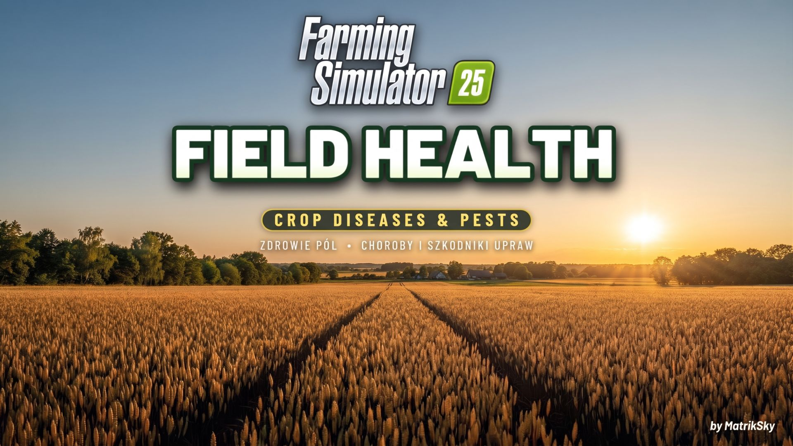
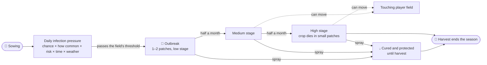
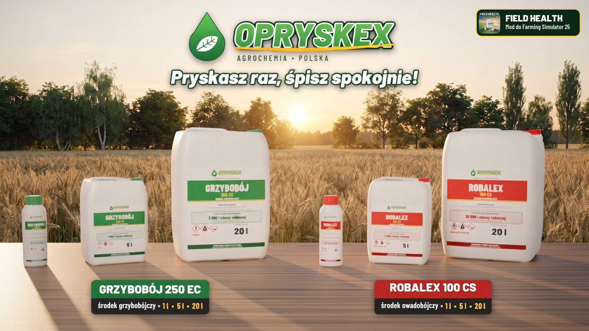

<div align="center">



# Field Health – Crop Diseases & Pests

**Crop diseases and pests for Farming Simulator 25 – realism with a relaxed, casual style of play.**

[](https://www.farming-simulator.com/)
[](https://github.com/MatrikSky/Field_Health_-_Crop_Diseases_-_Pests/releases)
[](https://github.com/MatrikSky/Field_Health_-_Crop_Diseases_-_Pests/releases)
[](LICENSE)
[](#-compatibility)
[](#-compatibility)

**[⬇️ Download](https://github.com/MatrikSky/Field_Health_-_Crop_Diseases_-_Pests/releases/latest/download/FS25_FieldHealth.zip)** &nbsp;•&nbsp; **[KingMods](https://www.kingmods.net/en/fs25/mods/83657/field-health-crop-diseases-pests)** &nbsp;•&nbsp; **[Report a bug](https://github.com/MatrikSky/Field_Health_-_Crop_Diseases_-_Pests/issues)** &nbsp;•&nbsp; **[Changelog](CHANGELOG.md)** &nbsp;•&nbsp; **[All releases](https://github.com/MatrikSky/Field_Health_-_Crop_Diseases_-_Pests/releases)**

</div>

> [!IMPORTANT]
> **Early version.** This is the first public release of Field Health, so you may still find bugs or rough edges.
> Please report every problem and share your ideas for improvements – in the [issues](https://github.com/MatrikSky/Field_Health_-_Crop_Diseases_-_Pests/issues) here on GitHub or in the comments on [KingMods](https://www.kingmods.net/en/fs25/mods/83657/field-health-crop-diseases-pests). Every report helps to make the mod better!

---

## 📖 Contents

1. [Features](#-features)
2. [Download & Installation](#-download--installation)
3. [How It Works](#-how-it-works)
4. [Diseases & Pests](#-diseases--pests)
5. [How You Farm](#-how-you-farm)
6. [Weather](#-weather)
7. [How a Threat Develops](#-how-a-threat-develops)
8. [Spraying & Protection](#-spraying--protection)
9. [Watching Your Fields](#-watching-your-fields)
10. [Settings](#-settings)
11. [Tips](#-tips)
12. [Compatibility](#-compatibility)
13. [Console Commands](#-console-commands)
14. [Reporting Bugs](#-reporting-bugs)
15. [Contributing](#-contributing)
16. [FAQ](#-faq)
17. [License & Credits](#-license--credits)

## ✨ Features

Field Health adds crop diseases and pests to Farming Simulator 25. Threats appear on the fields of your farm during the season, develop and – if you do not fight them – destroy part of the crop. The mod is realistic but forgiving: a threat never covers the whole field, crop is destroyed only in the most severe stage, and one good spraying with each product protects the field until the end of the season.

- 🦠 **44 real threats** – 24 diseases and 20 pests that farmers deal with across Europe,[^poland] each with its own crops, months and growth stages.
- 🌦️ **A living risk** – how you farm (rotation, plowing, liming, mulching, fertilizing, weed control) and the weather of the last days change the infection pressure.
- 🧩 **Natural outbreaks** – irregular patches that grow, send small new patches downwind and can move to a touching field.
- 💧 **One spray cures** – fungicide or insecticide removes the threat and protects the field until harvest. The AI helper only sprays where it is needed.
- 🧴 **Real products** – 1 l bottles, 5 l and 20 l canisters with realistic labels of two brands: Opryskex and MST.
- 🗺️ **A clear overview** – a map page with five layers, a minimap layer, field info lines and notifications.
- ⚙️ **25 settings** – chances, speed, spread, damage, protection, usage and prices, all in the game menu.
- 🔌 **Plays well with others** – Precision Farming, onions of the Highlands Fishing DLC, mod maps, multiplayer and safe savegames.

<p align="right"><a href="#-contents">⬆️ Back to contents</a></p>

## 📦 Download & Installation

1. Download **`FS25_FieldHealth.zip`** from the [latest release](https://github.com/MatrikSky/Field_Health_-_Crop_Diseases_-_Pests/releases/latest/download/FS25_FieldHealth.zip) – or from [KingMods](https://www.kingmods.net/en/fs25/mods/83657/field-health-crop-diseases-pests).
2. Put the zip into your mods folder. Do not unpack it and do not rename it:
   ```text
   Documents/My Games/FarmingSimulator2025/mods
   ```
3. Start the game and activate **Field Health – Crop Diseases & Pests** for a new or an existing savegame.

> [!TIP]
> **Updating:** replace the old zip with the new one. Your fields, threats, protection and settings stay – every new version is tested against savegames of the earlier ones before it is released.

> [!NOTE]
> The mod saves its data only in two files of its own in the savegame folder: `fieldHealth.xml` and `fieldHealthMap.grle`. If you remove the mod, the game simply skips them – only the bottles and canisters you bought disappear from the map.

<p align="right"><a href="#-contents">⬆️ Back to contents</a></p>

## 🌱 How It Works

### The season step by step

1. **Sowing** starts the crop season. From that day the infection pressure on the field grows – fastest in the time of year and growth stage in which a threat attacks, in weather that suits it and on a neglected field.
2. When the pressure passes the threshold rolled for the field, a **patch of a disease or pests** appears. You get a notification with the field number and the product to spray.
3. An untreated threat **gets one stage worse every half month** and slowly spreads. In the severe stage it destroys crop in small patches every day.
4. **Spraying** removes the threat and protects the sprayed spots. A field sprayed almost completely is immune to that kind of threat until harvest.
5. **Harvest** ends the season: threats and protection disappear, and the harvested crop becomes the previous crop of the next one.



### Key numbers

Default values – the admin can change each of them in the settings (last column).

| Item | Default value | Setting that changes it |
|---|---|---|
| Disease chance per season | 15% for a well farmed field | Disease chance per season |
| Pest chance per season | 10% for a well farmed field | Pest chance per season |
| Threats on one field per season | at most one disease and one kind of pest | fixed |
| Diseases and pests in the mod | 24 diseases and 20 kinds of pests | fixed |
| Influence of farming on the risk | risk multiplier from 0.3 (model farming) to 5 (badly neglected field) | Influence of farming |
| Influence of the weather on the pressure | from ×0.2 (very unfavourable weather) to ×2.5 (ideal weather for the threat) | Influence of weather |
| Development of a threat | every half month the severity rises by one stage: low, medium, high | Threat progression |
| Largest area of a threat | 1.5% of the field in the low stage, 3% in the medium and 5% in the high one | Threat spread |
| Crop damage | only in the high stage: 3 small patches of crop per day | Crop damage |
| Full protection of a field | at least 90% of the field sprayed with the product | Coverage for full protection |
| Duration of the protection | until harvest | Spray protection |
| Moving to a neighbouring field | in the high stage a daily chance of 4% for pests and 2% for diseases | Spread to neighbouring fields |
| Crops without threats | NPC fields, meadows, grass, clover, alfalfa, poplar and catch crops | Threats on meadows and fodder crops |

### Where threats come from

Every player field with a growing crop can get **at most one disease and one kind of pest per season**. NPC fields, poplar and catch crops never get threats; meadows, grass, clover and alfalfa only when you enable it in the settings.

A threat does not appear on a random day. Every day the mod works out the infection pressure on the field and adds it to the sum of the days before. At the start of the season the field gets a random resistance threshold – when the sum passes it, the field gets infected. That is why a threat appears early in one season, late in another and not at all in a third.

The daily pressure comes from:

1. **The base chance** from the settings – by default 15% for a disease and 10% for pests over a season.
2. **The field's risk** – how you farm it: fertilizing, soil work, crop rotation and weeds ([How You Farm](#-how-you-farm)).
3. **How common the threat is** – common diseases and pests appear much more often than rare ones ([Diseases & Pests](#-diseases--pests)).
4. **The time of year and the growth stage** – outside its time a threat does not attack at all.
5. **The weather of the last days** – rain helps fungal diseases, warmth and drought help most pests ([Weather](#-weather)).

When an infection happens, the mod picks one of the threats that can attack the crop on that day. The chance of each is in proportion to its pressure of the day. Example: on wheat in May in rainy weather septoria or mildew appear most often, while stem rust, which is rare and likes heat, almost never does.

> [!TIP]
> **Spray before the infection.** If the field is sprayed with the right product on at least 90% of its area when the infection comes, the infection fails and the field gets no threat of that kind this season. With less coverage the threat can appear, but only on the parts that were not sprayed.

<details>
<summary><b>📊 Chance of a threat per season</b></summary>

This is how the field's risk changes the chance of a threat over the whole season with the default settings:

| Risk shown in the field info | Risk multiplier | Disease chance per season | Pest chance per season |
|---|---|---|---|
| low | 0.3 | 5% | 3% |
| low | 0.5 | 8% | 5% |
| low | 0.75 | 11% | 8% |
| normal | 1 | 15% | 10% |
| normal | 1.25 | 18% | 12% |
| elevated | 1.5 | 22% | 15% |
| elevated | 2 | 28% | 19% |
| high | 3 | 39% | 27% |
| high | 5 | 56% | 41% |

The table applies to a crop with an average set of threats that grows through all of their time. Crops attacked by many common diseases or pests get them more often (up to 1.4 times), crops with few threats less often (down to 0.5 times):

| Crop | Number of diseases | How often diseases (average = 100%) | Number of pests | How often pests (average = 100%) |
|---|---|---|---|---|
| wheat | 9 | 140% | 5 | 140% |
| barley | 8 | 140% | 4 | 140% |
| oat | 4 | 126% | 3 | 136% |
| rye | 7 | 140% | 5 | 140% |
| triticale | 10 | 140% | 5 | 140% |
| maize | 2 | 60% | 6 | 140% |
| canola | 4 | 136% | 6 | 140% |
| sunflower | 3 | 92% | 2 | 80% |
| soybean | 1 | 50% | 2 | 92% |
| pea | 4 | 132% | 3 | 128% |
| green beans | 3 | 92% | 3 | 128% |
| potato | 3 | 132% | 4 | 140% |
| sugar beet | 2 | 84% | 5 | 140% |
| spinach | 3 | 108% | 3 | 136% |
| carrot | 2 | 72% | 4 | 140% |
| onion | 3 | 92% | 4 | 132% |

</details>

<p align="right"><a href="#-contents">⬆️ Back to contents</a></p>

## 🦠 Diseases & Pests

There are **24 diseases**, fought with fungicide, and **20 pests**, fought with insecticide. Every threat attacks only its own crops, only in its months and growth stages, and has its own weather. How common a threat is follows data from Poland, where the mod was made:[^poland]

| How common | Weight when a threat is picked | What it means |
|---|---|---|
| 🔴 very common | 1.3 to 1.5 | appears almost every year |
| 🟠 common | 0.9 to 1.2 | appears in most years |
| 🟡 moderately common | 0.5 to 0.8 | appears in favourable years or only in parts of the country |
| 🔵 rare | 0.2 to 0.3 | appears now and then |

<details>
<summary><b>🌾 Diseases of cereals and maize (14)</b></summary>

| Disease | How common | Crops attacked | When it appears | Most dangerous growth stage | What helps it |
|---|---|---|---|---|---|
| Cereal powdery mildew | 🔴 very common | all cereals | March to July and September to November; worst in May | leaf development and tillering and stem elongation or budding | fertilizers with fast nitrogen; mild weather without rain |
| Septoria leaf blotch | 🔴 very common | wheat, triticale and spelt | March to July and October to November; worst in May and June | stem elongation or budding and heading and flowering | crop residues, especially without plowing; cool and rainy weather |
| Net blotch | 🟠 common | barley | March to June and October to November; worst in May | leaf development and tillering and stem elongation or budding | crop residues, especially without plowing; cool and rainy weather |
| Rhynchosporium leaf scald | 🟠 common | barley, rye, triticale and green rye | March to June and October to December; worst in April and May | leaf development and tillering and stem elongation or budding | crop residues, especially without plowing; cool and rainy weather |
| Brown rust | 🟠 common | wheat, triticale, spelt, rye and green rye | April to July and October to November; worst in June | heading and flowering | fertilizers with fast nitrogen; warm weather |
| Fusarium | 🟠 common | all cereals, millet, maize and sorghum | June to September; worst in June and July | heading and flowering | crop residues, especially without plowing; after maize (risk rises twice); warm and rainy weather |
| Yellow rust | 🟠 common | wheat, triticale and spelt | March to June and October to November; worst in May | stem elongation or budding | fertilizers with fast nitrogen; cool weather |
| Tan spot | 🟠 common | wheat, triticale and spelt | April to July; worst in June | heading and flowering | crop residues, especially without plowing; warm and rainy weather |
| Eyespot | 🟠 common | wheat, triticale, spelt, barley and rye | February to May and October to December; worst in April | leaf development and tillering | crop residues, especially without plowing; cool weather |
| Ramularia leaf spot | 🟡 moderately common | barley | May to July; worst in June | heading and flowering | cool and rainy weather |
| Northern corn leaf blight | 🟡 moderately common | maize and sorghum | June to September; worst in August | heading and flowering | crop residues, especially without plowing; after maize (risk +50%); warm and rainy weather |
| Oat crown rust | 🟡 moderately common | oat | May to August; worst in July | heading and flowering | fertilizers with fast nitrogen; warm weather |
| Snow mould | 🔵 rare | wheat, barley, rye, triticale and green rye | November to April; worst in March | emergence and leaf development and tillering | fertilizers with fast nitrogen; frost and lasting snow |
| Black stem rust | 🔵 rare | wheat, triticale, spelt, rye, barley and oat | June to August; worst in July | heading and flowering | heat |

</details>

<details>
<summary><b>🥔 Diseases of other crops (10)</b></summary>

| Disease | How common | Crops attacked | When it appears | Most dangerous growth stage | What helps it |
|---|---|---|---|---|---|
| Late blight | 🔴 very common | potato | May to September; worst in July | heading and flowering | warm and rainy weather |
| Cercospora leaf spot | 🟠 common | sugar beet, beetroot and spinach | June to October; worst in July and August | stem elongation or budding and heading and flowering | crop residues, especially without plowing; warm and rainy weather |
| Phoma stem canker | 🟠 common | canola and mustard | March to May and September to December; worst in October | leaf development and tillering | crop residues, especially without plowing; after canola or mustard (risk +60%); cool and rainy weather |
| Sclerotinia stem rot | 🟠 common | canola, mustard, sunflower, soybean, pea, beans, green beans, potato and carrot | May to September; worst in June | heading and flowering | acidic soil; after sunflower (risk +50%); after canola or mustard (risk +50%); after legumes or clover (risk +30%); warm and rainy weather |
| Downy mildew | 🟠 common | onion, spinach and pea | April to September; worst in June and July | stem elongation or budding and heading and flowering | fertilizers with fast nitrogen; cool and rainy weather |
| Beet powdery mildew | 🟠 common | sugar beet and beetroot | June to September; worst in August | heading and flowering | fertilizers with fast nitrogen; warm and dry weather |
| Alternaria | 🟡 moderately common | potato, carrot, parsnip, canola, mustard, sunflower and onion | June to September; worst in July and August | heading and flowering and ripe for harvest | crop residues, especially without plowing; warm weather |
| Ascochyta blight | 🟡 moderately common | pea, beans and green beans | May to August; worst in June | heading and flowering | crop residues, especially without plowing; after legumes or clover (risk +50%); cool and rainy weather |
| Grey mould | 🟡 moderately common | grapes, sunflower, pea, beans, green beans, spinach, buckwheat and onion | May to October; worst in July and August | heading and flowering and ripe for harvest | fertilizers with fast nitrogen; cool and rainy weather |
| Light leaf spot | 🟡 moderately common | canola and mustard | February to May and October to December; worst in March | leaf development and tillering | crop residues, especially without plowing; after canola or mustard (risk +30%); cool weather |

</details>

<details>
<summary><b>🌾 Pests of cereals and maize (9)</b></summary>

| Pest | How common | Crops attacked | When it appears | Most dangerous growth stage | What helps it |
|---|---|---|---|---|---|
| Aphids | 🔴 very common | almost all field crops | April to November; worst in June | leaf development and tillering and stem elongation or budding | fertilizers with fast nitrogen; weeds; warm and dry weather |
| Cereal leaf beetles | 🔴 very common | all cereals and millet | April to July; worst in May and June | stem elongation or budding | weeds; warm and dry weather |
| European corn borer | 🟠 common | maize, sorghum and millet | June to September; worst in July | heading and flowering | unmulched stubble; after maize (risk +50%); warm and dry weather |
| Wireworms | 🟡 moderately common | potato, maize, sugar beet, beetroot, carrot, parsnip and onion | April to September; worst in May | emergence | no plowing; after grassland (risk rises 2.5-fold); after legumes or clover (risk +30%); moist soil |
| Frit fly | 🟡 moderately common | oat, wheat, barley, rye, triticale, maize and millet | April to July and September to October; worst in June | emergence and leaf development and tillering | weeds; after grassland (risk +50%); mild weather |
| Wheat blossom midges | 🟡 moderately common | wheat, triticale, spelt and rye | May to July; worst in June | heading and flowering | after cereals (risk +30%); mild and humid weather |
| Cutworms | 🟡 moderately common | sugar beet, beetroot, potato, maize, carrot, parsnip, onion and sunflower | May to September; worst in July and August | leaf development and tillering | no plowing; weeds; heat and drought |
| Western corn rootworm | 🔵 rare | maize | June to September; worst in July and August | heading and flowering | no plowing; after maize (risk rises three times); warm and dry weather |
| Cereal ground beetle | 🔵 rare | wheat, barley, rye and triticale | April to May and September to November; worst in October | emergence and leaf development and tillering | no plowing; after cereals (risk +50%); mild weather |

</details>

<details>
<summary><b>🥔 Pests of other crops (11)</b></summary>

| Pest | How common | Crops attacked | When it appears | Most dangerous growth stage | What helps it |
|---|---|---|---|---|---|
| Pollen beetles | 🔴 very common | canola and mustard | March to June; worst in April | stem elongation or budding | weeds; mild weather |
| Colorado potato beetles | 🔴 very common | potato | May to September; worst in June and July | stem elongation or budding and heading and flowering | after potatoes (risk +50%); warm and dry weather |
| Rape stem weevils | 🔴 very common | canola and mustard | February to May; worst in March | leaf development and tillering and stem elongation or budding | after canola or mustard (risk +20%); mild weather |
| Flea beetles | 🟠 common | canola, mustard, sugar beet, beetroot and spinach | April to June and August to October; worst in September | emergence | weeds; after canola or mustard (risk +20%); warm and dry weather |
| Onion fly | 🟠 common | onion | April to September; worst in May | emergence and leaf development and tillering | no plowing; after onions (risk +50%); mild and humid weather |
| Cabbage seed weevil | 🟠 common | canola and mustard | April to June; worst in May | heading and flowering | weeds; mild weather |
| Carrot fly | 🟠 common | carrot and parsnip | May to October; worst in August | leaf development and tillering and stem elongation or budding | no plowing; after carrots or parsnips (risk +50%); mild and humid weather |
| Thrips | 🟠 common | onion, pea, beans and green beans | May to September; worst in July and August | stem elongation or budding and heading and flowering | weeds; heat and drought |
| Pea leaf weevils | 🟡 moderately common | pea, beans, green beans and soybean | April to June; worst in May | emergence and leaf development and tillering | after legumes or clover (risk +40%); mild weather |
| Mangold fly | 🟡 moderately common | sugar beet, beetroot and spinach | April to July; worst in May | leaf development and tillering | weeds; mild and humid weather |
| Turnip sawfly | 🟡 moderately common | canola and mustard | August to October; worst in September | leaf development and tillering | weeds; mild weather |

</details>

Crops of maps that the mod does not know can get grey mould and aphids. Onions of the Highlands Fishing DLC and of mods are recognised automatically.

### Seasons and growth stages

Every threat has its time: it attacks only in certain months and only in certain growth stages of the crop. Within that time it has a peak, when it is most dangerous. Outside its time a threat does not appear at all – it cannot come from a neighbouring field either.

<details>
<summary><b>🌿 Growth stages</b></summary>

| Growth stage | What happens to the plant | Usual time (roughly) | Most dangerous for |
|---|---|---|---|
| emergence | germination and the first leaves | winter wheat – October and November, winter canola – August and September, potato – May | flea beetles, onion fly, pea weevils, wireworms, frit fly and snow mould |
| leaf development and tillering | leaf development, tillering of cereals, canola rosette | winter wheat – November to March, winter canola – September to March, potato – May to June | aphids, powdery mildew, stem weevils, onion fly, net blotch and leaf scald |
| stem elongation or budding | stem growth, stem elongation of cereals, buds appear | winter wheat – April and May, winter canola – March and April, potato – June | aphids, pollen beetles, potato beetles, powdery mildew, septoria and leaf beetles |
| heading and flowering | heading, flowering and seed setting | winter wheat – May and June, winter canola – April and May, potato – June and July | late blight, potato beetles, septoria, cercospora, seed weevil and brown rust |
| ripe for harvest | the crop is ready to harvest | winter wheat and winter canola – July, potato – August and September | alternaria and grey mould |

The mod reads the stage from the crop's growth state in the game: the first 20% of the growing time are emergence, up to 45% leaf development and tillering, up to 70% stem elongation or budding, then heading and flowering, and a crop that is ready to harvest is ripe. Months follow the game calendar (the first period of the year is March), so the days per period do not change when threats attack.

</details>

<details>
<summary><b>📅 Calendar – when to be careful</b></summary>

The main months are those in which the pressure of the threats on the crop is highest. Spraying shortly before them prevents most infections.

| Crop | When diseases appear most | Most common diseases | When pests appear most | Most common pests |
|---|---|---|---|---|
| wheat | April to June | septoria, powdery mildew and yellow rust | May to June | aphids, leaf beetles and frit fly |
| barley | April to June | powdery mildew, leaf scald and net blotch | May to June | aphids, leaf beetles and frit fly |
| oat | June to July | fusarium, powdery mildew and crown rust | May to June | aphids, leaf beetles and frit fly |
| rye | April to June | powdery mildew, leaf scald and brown rust | May to June | aphids, leaf beetles and frit fly |
| triticale | April to June | septoria, powdery mildew and leaf scald | May to June | aphids, leaf beetles and frit fly |
| maize | June to August | fusarium and corn leaf blight | May to July | aphids, corn borer and wireworms |
| canola | March to November | phoma, sclerotinia and alternaria | April to May | pollen beetles, aphids and flea beetles |
| sunflower | June to August | sclerotinia, alternaria and grey mould | May to July | aphids and cutworms |
| soybean | May to July | sclerotinia | May to June | aphids and pea weevils |
| pea | May to July | downy mildew, sclerotinia and ascochyta | May to July | aphids, thrips and pea weevils |
| green beans | May to July | sclerotinia, ascochyta and grey mould | May to July | aphids, thrips and pea weevils |
| potato | June to August | late blight, sclerotinia and alternaria | May to July | aphids, potato beetles and wireworms |
| sugar beet | July to September | cercospora and beet mildew | May to June | aphids, flea beetles and mangold fly |
| spinach | June to August | cercospora, downy mildew and grey mould | May to June | aphids, flea beetles and mangold fly |
| carrot | June to August | sclerotinia and alternaria | May to August | aphids, carrot fly and wireworms |
| onion | June to August | downy mildew, alternaria and grey mould | May to August | onion fly, thrips and wireworms |

</details>

<p align="right"><a href="#-contents">⬆️ Back to contents</a></p>

## 🚜 How You Farm

The field's risk is a multiplier of the infection pressure that comes from how you farm the field. The mod works it out for every threat separately; the field info box shows the highest disease and pest risk and the main cause. The multipliers below multiply with each other, and the result always stays between 0.3 and 5.

| Risk in the field info | Risk multiplier | What it usually means |
|---|---|---|
| low | up to 0.85 | well farmed field: manure, catch crop, rotation |
| normal | 0.85 to 1.25 | ordinary, proper farming |
| elevated | 1.25 to 2 | one kind of neglect; the box also shows the main cause |
| high | above 2 | several kinds of neglect, e.g. monoculture without plowing |

<details>
<summary><b>🧪 Fertilizing</b></summary>

| Fertilizing | Threats affected | Change of risk |
|---|---|---|
| No fertilizer (without Precision Farming) | all diseases | +25% |
|   | all pests | +15% |
| Manure | soil-borne diseases (sclerotinia) | −30% |
|   | other diseases | −10% |
|   | soil pests (wireworms, cutworms, onion fly, carrot fly, corn rootworm and ground beetle) | +15% |
| Slurry | threats that like lush growth: powdery mildew, brown rust, snow mould, grey mould, yellow rust, beet mildew, downy mildew, crown rust and aphids | +25% |
| Digestate | the same threats as slurry | +15% |
| Liquid fertilizer | the same threats as slurry | +10% |
| Solid mineral fertilizer | none – it only counts as fertilizing done | no change |

</details>

<details>
<summary><b>🚜 Soil work and weeds</b></summary>

| Neglect | Threats affected | Change of risk (fully neglected field) |
|---|---|---|
| No plowing | diseases surviving on crop residues (septoria, fusarium, net blotch, alternaria, cercospora, tan spot, eyespot, leaf scald, phoma, light leaf spot, ascochyta and corn leaf blight) | +60% |
|   | soil pests (wireworms, cutworms, onion fly, carrot fly, corn rootworm and ground beetle) | +50% |
|   | pests overwintering in stalks (corn borer) | +40% |
| Unmulched stubble | pests overwintering in stalks | +80% |
|   | diseases surviving on crop residues | +30% |
| No liming | soil-borne diseases | +50% |
|   | other diseases | +15% |
| No rolling | soil pests | +20% |
| Weeds | pests multiplying on weeds (aphids, leaf beetles, pollen beetles, seed weevil, flea beetles, turnip sawfly, frit fly, cutworms, mangold fly and thrips) | rises twice |
|   | other pests | +40% |
|   | diseases | +20% |

The values are for a completely neglected field – partial neglect raises the risk in proportion. Only field work enabled in the game settings counts: without required plowing, not plowing changes nothing. The mod checks the field at 36 points and only where the crop grows, so tramlines and paths across the field do not count as neglect. Stubble and rolling count as missing only when three quarters of the field lack them. Stubble counts only after a harvest on this field and not after plowing. In FS25 weeds do not grow after plowing.

</details>

<details>
<summary><b>🔄 Crop rotation and catch crops</b></summary>

| Situation | Threats affected | Change of risk |
|---|---|---|
| The same crop as last year (monoculture) | all threats | +80% |
| A crop of the same family, e.g. wheat after barley | all threats | +30% |
| Catch crop before the main crop | soil-borne diseases and soil pests | −40% |
|   | other threats | −10% |
| Crop after maize | fusarium – risk rises twice; corn leaf blight – risk +50%; corn borer – risk +50%; corn rootworm – risk rises three times | depends on the threat |
| Crop after sunflower | sclerotinia – risk +50% | depends on the threat |
| Crop after canola or mustard | sclerotinia – risk +50%; phoma – risk +60%; light leaf spot – risk +30%; stem weevils – risk +20%; flea beetles – risk +20% | depends on the threat |
| Crop after legumes or clover | sclerotinia – risk +30%; ascochyta – risk +50%; wireworms – risk +30%; pea weevils – risk +40% | depends on the threat |
| Crop after potatoes | potato beetles – risk +50% | depends on the threat |
| Crop after grassland | wireworms – risk rises 2.5-fold; frit fly – risk +50% | depends on the threat |
| Crop after cereals | wheat midges – risk +30%; ground beetle – risk +50% | depends on the threat |
| Crop after onions | onion fly – risk +50% | depends on the threat |
| Crop after carrots or parsnips | carrot fly – risk +50% | depends on the threat |
| Meadows, alfalfa, clover and grapes | perennial crops – growing them again is no monoculture | no change |

</details>

The setting **Influence of farming** strengthens or weakens all these factors at once: *None* – every field has risk 1, *Low* – the differences are about half as large, *Normal* – as in the tables, *High* – half as large again.

<p align="right"><a href="#-contents">⬆️ Back to contents</a></p>

## ⛅ Weather

Every in-game hour the mod reads the temperature and whether it rains. At the end of the day it works out the mean temperature of the day and the share of rainy hours. Wetness has a memory: half of it comes from the last day and half from the days before, because leaves stay wet long after rain. Every threat has a weather profile – a temperature range and how it deals with rain.

<details>
<summary><b>🌡️ Weather profiles</b></summary>

| Weather that helps the threat | Best temperature | Temperature range of attacks | Pressure after rainy days | Pressure after dry days | Threats with this profile |
|---|---|---|---|---|---|
| Frost and lasting snow | −2 to 5 °C | −10 to 12 °C | 🔴 +80% | 🟢 −20% | snow mould |
| Cool weather | 6 to 15 °C | 0 to 22 °C | 🔴 +70% | 🟢 −10% | yellow rust, eyespot and light leaf spot |
| Mild weather without rain | 12 to 22 °C | 4 to 28 °C | 🟢 −30% | +10% | powdery mildew |
| Cool and rainy weather | 12 to 20 °C | 4 to 27 °C | 🔴 +80% | 🟢 −40% | septoria, net blotch, grey mould, leaf scald, ramularia, phoma, ascochyta and downy mildew |
| Warm weather | 15 to 25 °C | 8 to 32 °C | 🔴 +50% | −10% | brown rust, alternaria and crown rust |
| Warm and rainy weather | 17 to 26 °C | 10 to 32 °C | 🔴 +80% | 🟢 −40% | fusarium, sclerotinia, late blight, cercospora, tan spot and corn leaf blight |
| Heat | 20 to 30 °C | 12 to 36 °C | 🔴 +40% | −10% | stem rust |
| Warm and dry weather | 18 to 28 °C | 8 to 35 °C | 🟢 −60% | 🔴 +20% | beet mildew, aphids, leaf beetles, potato beetles, corn borer, flea beetles and corn rootworm |
| Heat and drought | 22 to 32 °C | 12 to 38 °C | 🟢 −60% | 🔴 +30% | cutworms and thrips |
| Mild weather | 12 to 22 °C | 5 to 30 °C | 🟢 −30% | +10% | pollen beetles, stem weevils, seed weevil, turnip sawfly, frit fly, pea weevils and ground beetle |
| Mild and humid weather | 14 to 22 °C | 6 to 30 °C | 🔴 +50% | −10% | wheat midges, mangold fly, onion fly and carrot fly |
| Moist soil | 10 to 20 °C | 4 to 28 °C | 🔴 +50% | −10% | wireworms |

</details>

A temperature outside the range lowers the pressure to 0.4 times, a temperature in the optimum raises it to 1.2 times. Rain changes the pressure from 0.4 to 1.8 times – up for threats that like moisture, down for those that like drought. Together the weather changes the pressure from 0.2 to 2.5 times.

<details>
<summary><b>🌧️ Examples after a few days of the same weather</b></summary>

🔴 the threat grows, 🟢 it shrinks:

| Threat | Cool and rainy (10 °C) | Warm and rainy (20 °C) | Warm and dry (22 °C) | Heat and drought (30 °C) | Frost and snow (−3 °C) |
|---|---|---|---|---|---|
| Late blight | 🟢 −30% | 🔴 rises 2.2-fold | 🟢 −20% | 🟢 −60% | 🟢 −30% |
| Septoria | 🔴 +80% | 🔴 rises 2.2-fold | 🟢 −40% | 🟢 −80% | 🟢 −30% |
| Powdery mildew | 🟢 −30% | 🟢 −20% | 🔴 +30% | 🟢 −60% | 🟢 −70% |
| Yellow rust | 🔴 rises twice | +10% | 🟢 −70% | 🟢 −70% | 🟢 −40% |
| Brown rust | no change | 🔴 +80% | +10% | 🟢 −40% | 🟢 −50% |
| Fusarium | 🟢 −30% | 🔴 rises 2.2-fold | 🟢 −20% | 🟢 −60% | 🟢 −30% |
| Snow mould | +10% | 🟢 −30% | 🟢 −70% | 🟢 −70% | 🔴 +70% |
| Beet mildew | 🟢 −80% | 🟢 −50% | 🔴 +50% | +20% | 🟢 −80% |
| Aphids | 🟢 −80% | 🟢 −50% | 🔴 +50% | +20% | 🟢 −80% |
| Potato beetles | 🟢 −80% | 🟢 −50% | 🔴 +50% | +20% | 🟢 −80% |
| Pollen beetles | 🟢 −40% | 🟢 −20% | 🔴 +30% | 🟢 −60% | 🟢 −70% |
| Cutworms | 🟢 −80% | 🟢 −60% | 🔴 +60% | 🔴 +60% | 🟢 −80% |
| Onion fly | +20% | 🔴 +80% | +10% | 🟢 −60% | 🟢 −50% |

</details>

The setting **Influence of weather**: *None* – the weather does not count, *Low* – milder multipliers, *Normal* – as in the table, *High* – stronger. After a few warm, rainy days in summer watch potatoes and heading cereals in particular, and in a dry, hot summer – pests.

<p align="right"><a href="#-contents">⬆️ Back to contents</a></p>

## 📈 How a Threat Develops

A new threat is one or two irregular patches with a frayed edge and healthy gaps inside. It starts in the low stage. If you do not fight it, it goes through these steps:

| Step | What happens | Numbers with the default settings |
|---|---|---|
| New outbreak | 1 or 2 irregular patches appear, in the low stage | patch radius 4 to 10 m (small patches are more common); on a small field a patch covers at most 2% of it. The setting “Patch size” multiplies the radius by 0.6, 1 or 1.5. |
| Worse stage | the severity rises from low to medium and then to high; a new stage covers the patch step by step | one stage every half month; a new stage covers the whole patch within 3 days. The setting “Threat progression” changes this to a month or a quarter of a month. |
| Spreading | the edge of the patch grows unevenly, and now and then a small new patch appears nearby, mostly downwind | new patches appear 4 to 12 m away with a radius of 2 to 5 m. A threat covers at most 1.5% of the field in the low stage, 3% in the medium and 5% in the high one. The setting “Threat spread” multiplies these values by 0.5, 1 or 2. |
| Crop damage | only in the high stage and only inside the infected area; destroyed crop yields nothing | 3 small patches a day, each with a radius of 1 to 2 m. The setting “Crop damage” switches it off or changes it to 1 or 6 patches a day. |
| Moving to a neighbouring field | from the medium stage to a touching player field, if a crop the threat attacks grows there in the right time and stage and the field is not fully protected | up to 8 m from the field edge. In the high stage a daily chance of 4% for pests and 2% for diseases, half of it in the medium stage. The setting “Spread to neighbouring fields” multiplies the chance by 0.5, 1 or 2. |
| Notifications | about a new threat, about the high stage and about a threat that came from a neighbouring field | they go to the players of the farm that owns the field; they can be switched off in the settings |

Destroyed crop does not grow back and yields nothing at harvest. Spraying in advance or right after the notification is therefore the cheapest. Spraying in any stage removes the threat completely from the sprayed spots.

<p align="right"><a href="#-contents">⬆️ Back to contents</a></p>

## 💧 Spraying & Protection

The products are made by the (fictional) Polish company **Opryskex**: the fungicide *Grzybobój 250 EC* (green label) and the insecticide *Robalex 100 CS* (red label). When buying you can choose the **MST** brand (Mafia Solec Team) instead: *Solectop 280 SC* and *Mafiozol 50 EW*. They work the same, only the label differs.

<p align="center">
  
  
</p>

You buy them in the shop in 1 l bottles and in 5 l and 20 l canisters. Put the container next to the sprayer and fill it as from a pallet. The game does not mix the concentrate with water, so the content of a container is all the spray mixture it makes. The bigger the container, the cheaper per hectare.

| Container | Fungicide (fights diseases) | Insecticide (fights pests) | Buy at once |
|---|---|---|---|
| Bottle 1 l | 290 l of spray mixture – enough for 1 ha; price 50 | 1,450 l of spray mixture – enough for 5 ha; price 80 | 1 to 12 pieces |
| Canister 5 l | 1,450 l of spray mixture – enough for 5 ha; price 220 | 7,250 l of spray mixture – enough for 25 ha; price 350 | 1 to 8 pieces |
| Canister 20 l | 5,800 l of spray mixture – enough for 20 ha; price 800 | 29,000 l of spray mixture – enough for 100 ha; price 1,200 | 1 to 8 pieces |
| Rate (setting 100%) | 1 l of concentrate per hectare, about 290 l of spray mixture | 0.2 l of concentrate per hectare, about 290 l of spray mixture |   |

### How protection works

| Rule | How it works |
|---|---|
| What spraying does | removes threats of its kind from the sprayed spot and protects the spot against a new infection |
| Full protection of a field | with at least 90% of the area sprayed the whole field is immune to that kind of threat; the threshold can be set from 75% to 95% |
| Duration | until harvest by default; in the settings it can be shortened to 2 months, 1 month or half a month after the last spraying |
| When the protection ends | after sowing and after harvest, because a new crop season starts |
| Rate | from 25% to 200%, default 100%, i.e. about 290 l of mixture per hectare; the rate changes only the consumption, not the effect |
| AI worker | sprays the whole field until it is fully protected, then only the spots with a threat |
| Unloading the sprayer | the liquid goes into 20 l canisters; one holds 5,800 l of fungicide mixture or 29,000 l of insecticide mixture |
| Fertilizing and weeds | fungicide and insecticide do not fertilize and do not kill weeds |

> [!WARNING]
> - Spray **after emergence** – sowing and harvest remove the protection.
> - Fungicide does not protect against pests and insecticide not against diseases. **Full protection needs both.**
> - Missed wedges and headlands count: below 90% coverage a threat can appear on unsprayed strips.
> - The products do not fertilize and do not kill weeds.
> - With a shorter spray protection (setting) the protection of the whole field ends that long after the last spraying.

<p align="right"><a href="#-contents">⬆️ Back to contents</a></p>

## 🔍 Watching Your Fields

### Field info box

While you are on a field, the field info box shows:

- **Disease** and **Pests** – the active threat and its severity (low, medium, high),
- **Disease risk** and **Pest risk** – low, normal, elevated or high, and from elevated on also the main cause,
- **Protection – diseases** and **Protection – pests** – how much of the field is sprayed,
- a hint which product fights the threat.

### Map

In **ESC > Map** choose the page **Crop protection**. Below its title a second selector with arrows switches between five layers. Clicking a legend entry hides it on the map. Only fields of your farm with a growing crop are shown. Click a farmland to see the threats and the protection of its fields.

| Map layer | Colour and meaning | What to do |
|---|---|---|
| Protection |  Not protected | spray the field with fungicide and insecticide |
|   |  One product | spray the field with the other product |
|   |  Fungicide and insecticide | nothing – the field is protected |
| Diseases and Pests |  Healthy crop | nothing – there is no threat here |
|   |  Low stage | spray the field in the next days |
|   |  Medium stage | spray as soon as possible – the threat can move to a neighbouring field |
|   |  High stage | spray at once – the crop is already dying |
| Disease types and Pest types | every threat has its own colour (table below) | see exactly what attacks the field |

<details>
<summary><b>🎨 Colours of the threat types</b></summary>

| Diseases |   | Pests |   |
|---|---|---|---|
|  Powdery mildew |  Tan spot |  Aphids |  Frit fly |
|  Septoria |  Eyespot |  Leaf beetles |  Wheat midges |
|  Brown rust |  Leaf scald |  Pollen beetles |  Cutworms |
|  Fusarium |  Ramularia |  Potato beetles |  Mangold fly |
|  Net blotch |  Stem rust |  Corn borer |  Onion fly |
|  Snow mould |  Phoma |  Wireworms |  Thrips |
|  Sclerotinia |  Light leaf spot |  Stem weevils |  Carrot fly |
|  Alternaria |  Beet mildew |  Seed weevil |  Pea weevils |
|  Late blight |  Ascochyta |  Flea beetles |  Corn rootworm |
|  Cercospora |  Downy mildew |  Turnip sawfly |  Ground beetle |
|  Grey mould |  Corn leaf blight |   |   |
|  Yellow rust |  Crown rust |   |   |

</details>

### Minimap

<kbd>Left Alt</kbd> + <kbd>&#92;</kbd> switches the minimap layer: protection, diseases, pests and no layer. You can change the keys during the game in **ESC > Settings > Controls**, entry *Field Health – crop protection layer on the minimap* (the main menu does not list mod keys, because mods are loaded with the savegame).

### Notifications

You get a notification about a new threat, about the severe stage and about a threat that came from a neighbouring field. They go to the players of the farm that owns the field, each in their own language, and can be switched off in the settings.

<p align="right"><a href="#-contents">⬆️ Back to contents</a></p>

## 🔧 Settings

You find the mod settings in **ESC > Settings > Game**, in the section *Field Health – diseases and pests*. They are saved with the savegame. In multiplayer only the server admin can change them. Move over an option in the game to see its description.

| Setting | Values | Default | What it changes |
|---|---|---|---|
| Crop threats | on or off | on | switches new threats on or off |
| Disease chance per season | 0% to 50% | 15% | disease chance per season on a well farmed field |
| Pest chance per season | 0% to 50% | 10% | pest chance per season on a well farmed field |
| Influence of farming | none, low, normal or high | normal | how strongly the way you farm changes the risk |
| Influence of weather | none, low, normal or high | normal | how strongly the weather of the last days changes the pressure |
| Risk from stubble | on or off | on | whether unmulched stubble after harvest raises the risk (tramlines never count) |
| Threats on meadows and fodder crops | on or off | off | whether meadows, grass, clover and alfalfa can get threats |
| Threat progression | slow, normal or fast | normal | how fast a threat gets worse: every month, half month or quarter of a month |
| Threat spread | small, medium or large | medium | the largest share of the field a threat can cover: half, normal or twice as much |
| Patch size | small, normal or large | normal | size of new outbreaks: 0.6 times, normal or 1.5 times |
| Spread to neighbouring fields | off, rarely, sometimes or often | sometimes | how often a threat moves to a neighbouring player field |
| Crop damage | off, low, normal or high | normal | how many crop patches die per day in the high stage: none, 1, 3 or 6 |
| Coverage for full protection | 75%, 80%, 85%, 90% or 95% | 90% | how much of the field must be sprayed to protect the whole field |
| Spray protection | until harvest, 2 months, 1 month or half a month | until harvest | how long spraying protects |
| Fungicide rate | 25% to 200% | 100% | fungicide used per hectare; the effect stays the same |
| Insecticide rate | 25% to 200% | 100% | insecticide used per hectare; the effect stays the same |
| Fungicide bottle price | 10 to 200 | 50 | shop price of the 1 l bottle |
| Insecticide bottle price | 10 to 200 | 80 | shop price of the 1 l bottle |
| Fungicide 5 l canister price | 50 to 600 | 220 | shop price of the 5 l canister |
| Insecticide 5 l canister price | 50 to 600 | 350 | shop price of the 5 l canister |
| Fungicide 20 l canister price | 200 to 2,000 | 800 | shop price of the 20 l canister |
| Insecticide 20 l canister price | 200 to 2,000 | 1,200 | shop price of the 20 l canister |
| Threat limit per farm | unlimited, 1, 2, 3, 5 or 10 | unlimited | how many new threats one farm can get per year |
| Threat notifications | on or off | on | notifications about new and severe threats |
| Field info lines | on or off | on | whether the field info box shows the data of the mod |

<p align="right"><a href="#-contents">⬆️ Back to contents</a></p>

## 💡 Tips

**A plan for healthy fields**

1. Fertilize as needed, lime and do not sow the same crop two years in a row. Sow a catch crop between main crops.
2. Before the main months of the threats ([calendar](#-diseases--pests)) spray the field with fungicide and insecticide. Once per season is enough if you cover at least 90% of the field.
3. Check the *Protection* layer on the map – green fields are protected against both kinds of threats.
4. After a notification spray the named field with the named product before the threat reaches the severe stage.
5. An AI worker with fungicide or insecticide sprays unprotected fields completely and protected ones only where a threat is.

**Watch out**

- Monoculture and no plowing are the most common causes of high risk, e.g. wheat after wheat without plowing helps septoria, tan spot and fusarium.
- Maize before wheat clearly raises the risk of fusarium, grassland before potatoes the risk of wireworms.
- Slurry and liquid fertilizer give lush growth, which mildew, rusts and aphids like.
- A rainy summer is the time of late blight, septoria and fusarium, a dry and hot one the time of aphids, potato beetles, thrips and cutworms.
- Canola has two dangerous times: autumn (flea beetles, turnip sawfly, phoma) and spring (stem weevils, pollen beetles, sclerotinia).
- A threat in the medium or severe stage can move to a touching player field.

<p align="right"><a href="#-contents">⬆️ Back to contents</a></p>

## 🔌 Compatibility

- **Precision Farming** – Field Health works as its extension and uses its soil maps. Instead of fertilizing in general the nitrogen compared with the target counts, and instead of liming in general the soil pH. The console command `fhPrecisionFarming` writes to the log how the mod reads Precision Farming data.
- **Highlands Fishing DLC** – its onions get their own diseases and pests. Onions of mods are recognised automatically too (the log says so).
- **Maps and mod crops** – the mod works on any map. Crops it does not know can get grey mould and aphids.
- **Multiplayer** – the simulation runs on the server and the players see its results. The settings and the commands `fhSet`, `fhClear` and `fhDailyTick` are for the admin only.
- **Other mods** – every hook of Field Health calls the original game function, and an error in the mod is caught and written to the log, so it never breaks the game function. Sprayers and tanks of other mods accept the liquids, because they use the common names `FUNGICIDE` and `INSECTICIDE`.
- **Performance** – most of the work runs once per in-game day and is spread over several frames.
- **Languages** – English, Polish, French, German, Spanish (Spain and Latin America), Portuguese (Portugal and Brazil), Italian, Russian, Czech, Romanian and Hungarian. In other game languages you see the English texts. The tables of the in-game help are pictures in English and Polish; the other languages show the English tables for now.

<details>
<summary><b>🛰️ Precision Farming data and the risk</b></summary>

| Precision Farming data | Threats affected | Change of risk (at most) |
|---|---|---|
| Nitrogen deficit – up to 60 kg N/ha below the target | all diseases | +25% |
|   | all pests | +15% |
| Nitrogen excess – up to 60 kg N/ha above the target | threats that like lush growth: powdery mildew, brown rust, snow mould, grey mould, yellow rust, beet mildew, downy mildew, crown rust and aphids | +30% |
| pH 1 or more below the optimum | soil-borne diseases | +50% |
|   | other diseases | +15% |
| Light soil (loamy sand) | soil pests | +20% |
| Heavy soil (clay) | soil-borne diseases | +20% |
| No nitrogen target for the crop | the fertilizing recorded by the mod counts, as without Precision Farming | as for no fertilizer |

</details>

> [!NOTE]
> Multiplayer has been tested less than single player so far – reports from servers are very welcome.

> [!CAUTION]
> Do not use another crop disease mod (e.g. Crop Diseases) at the same time – both would handle the same fields. Field Health warns about it in the log.

<p align="right"><a href="#-contents">⬆️ Back to contents</a></p>

## 💻 Console Commands

The commands are for testing and for admins. To use them, enable the developer console in `Documents/My Games/FarmingSimulator2025/game.xml`:

```xml
<development>
    <controls>true</controls>
</development>
```

Then open the console in the game with the key below <kbd>Esc</kbd> and type a command.

| Command | What it does |
|---|---|
| `fhInfo [field number or here]` | shows field data: threats, risk, growth stage, month, weather and timing of every threat |
| `fhList` | lists the keys of all threats |
| `fhSet <field number or here> <threat key> [stage 1–3]` | puts a threat on a field (admin only) |
| `fhClear <field number or here>` | removes all threats of a field (admin only) |
| `fhDailyTick` | runs the daily check of the fields now (admin only) |
| `fhDebug [radius]` | shows threat and protection cells around you |
| `fhDebugLog` | switches detailed log messages on or off |
| `fhPrecisionFarming` | writes to the log how the mod reads Precision Farming data |

In multiplayer `fhSet`, `fhClear` and `fhDailyTick` are sent to the server and work only for the admin.

<p align="right"><a href="#-contents">⬆️ Back to contents</a></p>

## 🐞 Reporting Bugs

Found a bug? Please open an issue: **[github.com/MatrikSky/Field_Health_-_Crop_Diseases_-_Pests/issues](https://github.com/MatrikSky/Field_Health_-_Crop_Diseases_-_Pests/issues)**

1. **Copy your `log.txt` right after the problem** – before you start the game again, because the game overwrites it at every start:
   ```text
   Documents/My Games/FarmingSimulator2025/log.txt
   ```
2. **[Open a new issue](https://github.com/MatrikSky/Field_Health_-_Crop_Diseases_-_Pests/issues/new)** and describe what you did, what you expected and what happened.
3. **Attach the `log.txt`** – drag and drop it into the issue.

> [!IMPORTANT]
> Please always attach the **log.txt** to a bug report. Without it, most problems cannot be found.

Before you send the report, check that it has:

- [ ] the `log.txt` of the game session with the problem,
- [ ] what you did and what happened,
- [ ] the map you play and the list of your other mods,
- [ ] single player or multiplayer (dedicated server or hosted game),
- [ ] a screenshot, if it shows the problem.

> [!TIP]
> If the problem is about a field, stand on it, run `fhInfo here` in the console (see [Console Commands](#-console-commands)) and paste the output into the issue.

No GitHub account? Write in the comments on [KingMods](https://www.kingmods.net/en/fs25/mods/83657/field-health-crop-diseases-pests). Ideas and suggestions are welcome as issues too.

<p align="right"><a href="#-contents">⬆️ Back to contents</a></p>

## 🤝 Contributing

**Forks and pull requests are very welcome!** Fixes, improvements and new ideas – everything that makes the mod better. For bigger changes please open an issue first, so we can talk about the idea.

This repository is the mod itself – the files as they go into `FS25_FieldHealth.zip`:

```text
FS25_FieldHealth/
├── modDesc.xml             mod description, shop items, scripts, input action, help pages
├── icon_FieldHealth.dds    mod icon
├── scripts/
│   ├── core/               threats, risk, weather, simulation, field map, products, settings, savegame
│   ├── net/                multiplayer events
│   ├── gui/                map page, minimap, field info, farmland box, settings page, help
│   ├── FHHooks.lua         hooks into the game: sprayer, AI, field info, saving
│   └── FieldHealth.lua     entry point
├── xml/fillTypes.xml       the liquids FUNGICIDE and INSECTICIDE
├── pallets/                bottles and canisters: models, textures, shop items
├── l10n/                   texts in 13 languages (l10n_<language>.xml)
├── help/  hud/  brand/     help tables, liquid icons, brand logo
└── docs/images/            pictures of this README (not part of the mod)
```

To test a change, zip the content of the repository – `modDesc.xml` at the root of the zip, without `README.md`, `LICENSE`, `docs/` and `.git` – name it `FS25_FieldHealth.zip` and put it into your mods folder.

> [!IMPORTANT]
> **Keep savegames working.** Players have savegames of every released version, so a change must never:
> - rename or remove a shop item file in `pallets/` – bought items would vanish,
> - rename `FUNGICIDE` or `INSECTICIDE`,
> - change the id or the key of a threat (new threats get the next free id),
> - remove a setting or one of its values,
> - reorder the brand configurations (new ones go at the end),
> - rename a saved value or the savegame files `fieldHealth.xml` and `fieldHealthMap.grle`.
>
> A change of the savegame format needs a higher format version and a conversion of the old data when it is loaded.

A few more rules of the code:

- Every hook calls the original game function, and mod code runs through `FHUtil.protect`, so an error never breaks the game.
- All texts are in `l10n/` with the prefix `fh_`, in every language of the mod (13 files `l10n_<language>.xml`, e.g. `ea` is Latin American Spanish and `br` Brazilian Portuguese).
- Test in single player and, if you can, in multiplayer; the `log.txt` must stay free of errors.

Some files – `modDesc.xml`, the help images, the bottles and canisters – are made with tools that are not part of this repository. Edit them directly in a pull request; the author carries the change over into the tools.

**Version numbers** have four parts, **A.B.C.D** – *generation*, *features*, *fixes* and *hotfix*. Raising a number sets the ones after it to 0, e.g. a bug fix after 1.0.0.0 is 1.0.1.0 and a new feature 1.1.0.0. The [changelog](CHANGELOG.md) explains them and lists what every version changed.

<p align="right"><a href="#-contents">⬆️ Back to contents</a></p>

## ❓ FAQ

<details>
<summary><b>Is this the successor of “Crop Diseases” by BMP?</b></summary>

No. Field Health is a separate mod, built from scratch. The idea was taken from the “Crop Diseases” mod by BMP. Please do not use both mods at the same time.

</details>

<details>
<summary><b>Is the mod only for Poland?</b></summary>

No. It works on any map and in English. The diseases and pests are the common ones farmers deal with across Europe and beyond – mildew, rust, septoria, fusarium, aphids, Colorado potato beetle, corn borer and more. Only how often each threat appears is based on data from Poland, and the product labels are in Polish for fun.

</details>

<details>
<summary><b>Does it work on my map and with mod crops?</b></summary>

Yes. All crops of the base game and the onions of the Highlands Fishing DLC have their own threats. Crops of maps and mods that the mod does not know can get grey mould and aphids.

</details>

<details>
<summary><b>Do NPC fields get diseases?</b></summary>

No. NPC fields are left out on purpose, because you cannot spray them. A threat cannot move from your field to an NPC field either.

</details>

<details>
<summary><b>Why did a threat appear on a field I sprayed?</b></summary>

The field was sprayed on less than 90% of its area (missed wedges and headlands count), or the protection ended: sowing and harvest remove it, and a shorter spray protection in the settings ends it after the set time. Also check that you used the right product – fungicide for diseases, insecticide for pests.

</details>

<details>
<summary><b>Why does my AI worker not spray a field?</b></summary>

The AI only sprays where it is needed: a field that is fully protected against that kind of threat is skipped, and only the spots with a threat are sprayed again.

</details>

<details>
<summary><b>Can I turn off threats on meadows and fodder crops?</b></summary>

They are off by default. The setting *Threats on meadows and fodder crops* turns them on for clover and alfalfa; meadows and grass never get threats.

</details>

<details>
<summary><b>Which languages does the mod have?</b></summary>

English, Polish, French, German, Spanish (Spain and Latin America), Portuguese (Portugal and Brazil), Italian, Russian, Czech, Romanian and Hungarian. In other game languages you see the English texts. Apart from English and Polish, the tables of the in-game help are still in English.

</details>

<details>
<summary><b>Can I remove the mod from my savegame?</b></summary>

Yes. The game skips the two files of the mod in the savegame folder, and only the bottles and canisters you bought disappear from the map.

</details>

<details>
<summary><b>Does the mod cost FPS?</b></summary>

It should not. Most of the work runs once per in-game day and is spread over several frames.

</details>

<p align="right"><a href="#-contents">⬆️ Back to contents</a></p>

## 📜 License & Credits

**Field Health** by **MatrikSky** is licensed under the [Creative Commons Attribution 4.0 International License (CC BY 4.0)](https://creativecommons.org/licenses/by/4.0/) – see [LICENSE](LICENSE). You are free to copy, share, change and publish your own versions of the mod, if you:

- credit **MatrikSky** as the author of the original **Field Health** mod (ideally with a link to this repository),
- state that you made changes,
- keep the credits and licences of the models below.

| Part | Author | Licence | Source |
|---|---|---|---|
| Bottle model, based on “fertilizer Bottle” | shabanimate | [CC BY 4.0](https://creativecommons.org/licenses/by/4.0/) | [Sketchfab](https://sketchfab.com/3d-models/fertilizer-bottle-cc7676156d624bcc9853283d0f6d3e1c) |
| Canister models, based on “#6 Plastic Canister” | hoxsvl | [CC BY 4.0](https://creativecommons.org/licenses/by/4.0/) | [Sketchfab](https://sketchfab.com/3d-models/b87cd4d8f8b348e59daef66c6f0d3a1d) |
| Fonts of the labels and pictures: Barlow | Jeremy Tran | SIL Open Font License 1.1 | [GitHub](https://github.com/jpt/barlow) |
| Idea | taken from the “Crop Diseases” mod by BMP | | |

### 🙏 Thanks

Huge thanks to the whole **MST crew** (Mafia Solec Team), especially **Bronczek** and **Jankus** – and to everyone who plays the mod, reports bugs and shares ideas!

<p align="right"><a href="#-contents">⬆️ Back to contents</a></p>

[^poland]: How common each threat is follows data from Poland, where the mod was made. The threats themselves are found across Europe and in many other parts of the world.

<div align="center">

**Have fun and healthy fields!** 🌱

<sub>Field Health 1.1.0.0 • made by MatrikSky</sub>

</div>
