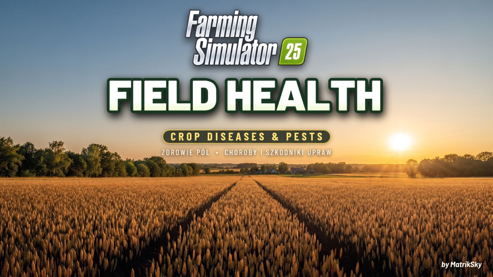
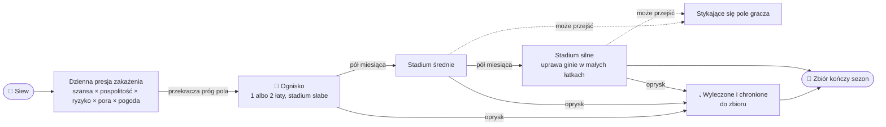
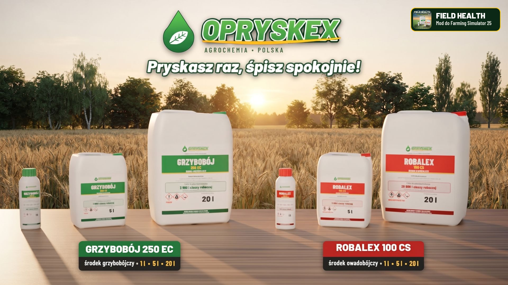
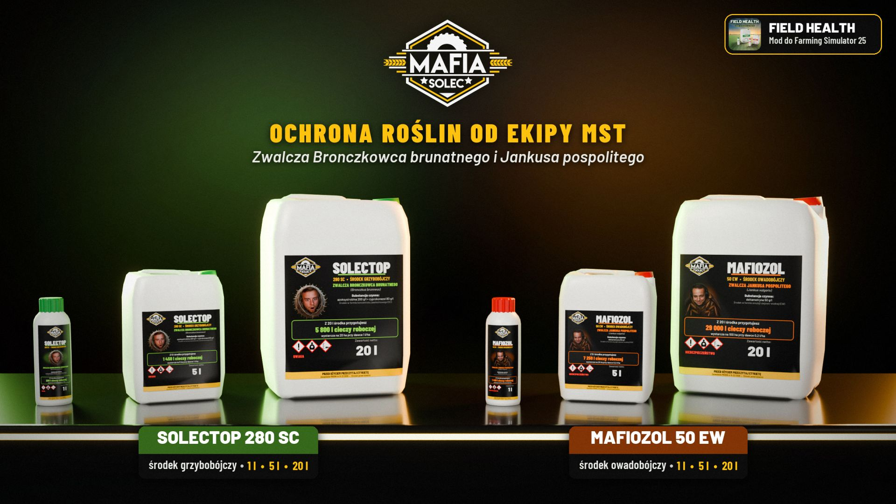

<div align="center">

[🇬🇧 English](README.md) &nbsp;•&nbsp; 🇵🇱 **Polski**



# Field Health: Crop Diseases & Pests

**Choroby i szkodniki upraw do Farming Simulator 25. Realistycznie, ale z myślą o spokojnej, swobodnej grze.**

[](https://www.farming-simulator.com/)
[](https://github.com/MatrikSky/Field_Health_-_Crop_Diseases_-_Pests/releases)
[](https://github.com/MatrikSky/Field_Health_-_Crop_Diseases_-_Pests/releases)
[](LICENSE)
[](#-zgodność)
[](#-języki)

**[⬇️ Pobierz](https://github.com/MatrikSky/Field_Health_-_Crop_Diseases_-_Pests/releases/latest/download/FS25_FieldHealth.zip)** &nbsp;•&nbsp; **[KingMods](https://www.kingmods.net/en/fs25/mods/83657/field-health-crop-diseases-pests)** &nbsp;•&nbsp; **[Zgłoś błąd](https://github.com/MatrikSky/Field_Health_-_Crop_Diseases_-_Pests/issues)** &nbsp;•&nbsp; **[Lista zmian](CHANGELOG.md)** &nbsp;•&nbsp; **[Wszystkie wydania](https://github.com/MatrikSky/Field_Health_-_Crop_Diseases_-_Pests/releases)**

</div>

> [!IMPORTANT]
> **Wczesna wersja.** To wciąż młody mod, więc mogą się zdarzyć błędy i niedoróbki.
> Zgłaszaj proszę każdy problem i dziel się pomysłami, tutaj w [zgłoszeniach](https://github.com/MatrikSky/Field_Health_-_Crop_Diseases_-_Pests/issues) albo w komentarzach na [KingMods](https://www.kingmods.net/en/fs25/mods/83657/field-health-crop-diseases-pests). Każde zgłoszenie pomaga ulepszyć mod!

---

## 📖 Spis treści

1. [Funkcje](#-funkcje)
2. [Pobieranie i instalacja](#-pobieranie-i-instalacja)
3. [Jak to działa](#-jak-to-działa)
4. [Choroby i szkodniki](#-choroby-i-szkodniki)
5. [Jak prowadzisz pole](#-jak-prowadzisz-pole)
6. [Pogoda](#-pogoda)
7. [Jak rozwija się zagrożenie](#-jak-rozwija-się-zagrożenie)
8. [Oprysk i ochrona](#-oprysk-i-ochrona)
9. [Pilnowanie pól](#-pilnowanie-pól)
10. [Ustawienia](#-ustawienia)
11. [Porady](#-porady)
12. [Języki](#-języki)
13. [Zgodność](#-zgodność)
14. [Komendy konsoli](#-komendy-konsoli)
15. [Zgłaszanie błędów](#-zgłaszanie-błędów)
16. [Współtworzenie](#-współtworzenie)
17. [FAQ](#-faq)
18. [Licencja i podziękowania](#-licencja-i-podziękowania)

## ✨ Funkcje

Twoje pola wreszcie żyją! Field Health dodaje do Farming Simulator 25 choroby i szkodniki upraw. Pojawiają się na polach w trakcie sezonu, rosną, a jeśli się nimi nie zajmiesz, niszczą część plonu. Mod jest realistyczny, ale wyrozumiały: zagrożenie nigdy nie zajmuje całego pola, uprawa ginie dopiero w najgorszym stadium, a jeden porządny oprysk każdym środkiem chroni pole do zbioru.

- 🦠 **44 prawdziwych zagrożeń:** 24 chorób i 20 szkodników, z którymi mierzą się rolnicy w całej Europie,[^poland] każde z własnymi uprawami, miesiącami i fazami wzrostu.
- 🌦️ **Ryzyko zależy od Ciebie:** płodozmian, orka, wapnowanie, mulczowanie, nawożenie, walka z chwastami i pogoda z ostatnich dni zmieniają presję zakażenia.
- 🧩 **Naturalne ogniska:** nieregularne łaty, które rosną, wysyłają z wiatrem małe nowe ogniska i mogą przeskoczyć na stykające się pole.
- 💧 **Jeden oprysk leczy:** fungicyd albo insektycyd usuwa zagrożenie i chroni pole do zbioru. Pomocnik AI pryska tylko tam, gdzie trzeba.
- 🧴 **Prawdziwe środki:** butelki 1 l oraz bańki 5 l i 20 l z realistycznymi etykietami dwóch marek, Opryskex i MST.
- 🗺️ **Przejrzysty podgląd:** strona mapy z pięcioma warstwami, warstwa na minimapie, linie w panelu informacji o polu i powiadomienia.
- ⚙️ **33 ustawienia:** wyłączenie całego moda, chorób albo szkodników, spokojny start, szanse, tempo, rozrost, szkody, ochrona, dawki i ceny, wszystko w zakładce Field Health w menu gry.
- 🌍 **20 języków:** język gry wybiera się automatycznie.
- 🔌 **Dogaduje się z innymi:** Precision Farming, cebula z DLC Highlands Fishing, DLC Beans & Alpacas, mapy z modów, gra wieloosobowa i bezpieczne zapisy.

<p align="right"><a href="#-spis-treści">⬆️ Wróć do spisu treści</a></p>

## 📦 Pobieranie i instalacja

1. Pobierz **`FS25_FieldHealth.zip`** z [najnowszego wydania](https://github.com/MatrikSky/Field_Health_-_Crop_Diseases_-_Pests/releases/latest/download/FS25_FieldHealth.zip) albo z [KingMods](https://www.kingmods.net/en/fs25/mods/83657/field-health-crop-diseases-pests).
2. Wrzuć zip do folderu modów tak, jak jest. Nie rozpakowuj go i nie zmieniaj nazwy:
   ```text
   Dokumenty/My Games/FarmingSimulator2025/mods
   ```
3. Uruchom grę i włącz **Zdrowie pól: choroby i szkodniki upraw** (w angielskiej wersji gry: Field Health: Crop Diseases & Pests) w nowym albo istniejącym zapisie.

> [!TIP]
> **Aktualizacja:** po prostu podmień stary zip na nowy. Twoje pola, zagrożenia, ochrona, ustawienia i kupione środki zostają. Każda nowa wersja jest przed wydaniem sprawdzana na zapisach z wcześniejszych wersji.

> [!NOTE]
> Mod trzyma swoje dane w dwóch własnych plikach w folderze zapisu, `fieldHealth.xml` i `fieldHealthMap.grle`. Jeśli usuniesz mod, gra po prostu je pominie. Z mapy znikną tylko kupione butelki i bańki.

<p align="right"><a href="#-spis-treści">⬆️ Wróć do spisu treści</a></p>

## 🌱 Jak to działa

### Sezon krok po kroku

1. **Siew** zaczyna sezon uprawy. Od tego dnia rośnie presja zakażenia na polu. Najszybciej rośnie w porze roku i fazie wzrostu, w której atakuje dane zagrożenie, przy pogodzie, którą lubi, i na zaniedbanym polu.
2. Gdy presja przekroczy próg wylosowany dla pola, pojawia się **ognisko choroby albo szkodników**. Dostajesz powiadomienie z numerem pola i środkiem, którego trzeba użyć.
3. Jeśli je zostawisz, zagrożenie **co pół miesiąca przechodzi w silniejsze stadium** i powoli się rozrasta. W stadium silnym codziennie niszczy małe łatki uprawy.
4. **Oprysk** usuwa zagrożenie i chroni opryskane miejsca. Pole opryskane prawie w całości jest odporne na ten rodzaj zagrożeń do zbioru.
5. **Zbiór** kończy sezon. Zagrożenia i ochrona znikają, a zebrana uprawa staje się przedplonem dla następnej.



### Najważniejsze liczby

To wartości domyślne. Admin może zmienić każdą z nich w ustawieniach (ostatnia kolumna).

| Parametr | Wartość domyślna | Ustawienie, które to zmienia |
|---|---|---|
| Szansa na chorobę w ciągu sezonu | 15% dla dobrze prowadzonego pola | Szansa na chorobę w sezonie |
| Szansa na szkodniki w ciągu sezonu | 10% dla dobrze prowadzonego pola | Szansa na szkodniki w sezonie |
| Zagrożenia na jednym polu w sezonie | najwyżej jedna choroba i jeden rodzaj szkodników | nie można zmienić |
| Liczba chorób i szkodników w modzie | 24 choroby i 20 rodzajów szkodników | nie można zmienić |
| Wpływ sposobu uprawy na ryzyko | mnożnik ryzyka od 0,3 (pole wzorowo prowadzone) do 5 (pole bardzo zaniedbane) | Wpływ sposobu uprawy |
| Wpływ pogody na presję zakażenia | od 0,2 raza (pogoda bardzo niesprzyjająca) do 2,5 raza (pogoda idealna dla zagrożenia) | Wpływ pogody |
| Rozwój zagrożenia | co pół miesiąca nasilenie rośnie o jeden stopień: słabe, średnie, silne | Tempo rozwoju zagrożeń |
| Największy obszar zagrożenia | 1,5% pola w stadium słabym, 3% w średnim i 5% w silnym | Zasięg zagrożeń |
| Niszczenie uprawy | dopiero w stadium silnym: 3 małe łaty uprawy dziennie | Niszczenie uprawy |
| Pełna ochrona pola | co najmniej 90% powierzchni pola opryskanej danym środkiem | Pokrycie dla pełnej ochrony |
| Czas działania oprysku | do zbioru | Czas działania oprysku |
| Przejście na sąsiednie pole | w stadium silnym codziennie 4% szansy dla szkodników i 2% dla chorób | Przenoszenie na sąsiednie pola |
| Uprawy, które nie chorują | pola NPC, łąki, trawa, koniczyna, lucerna, topola, poplony, banany i kawa | Zagrożenia na łąkach i uprawach pastewnych |

### Skąd biorą się zagrożenia

Każde pole gracza z rosnącą uprawą może dostać **w sezonie najwyżej jedną chorobę i jeden rodzaj szkodników**. Pola NPC, topola i poplony nigdy nie chorują, podobnie jak banany i kawa z DLC Beans & Alpacas, które mają tam własne choroby. Łąki, trawa, koniczyna i lucerna chorują tylko, jeśli włączysz to w ustawieniach.

Zagrożenie nie pojawia się w przypadkowym dniu. Każdego dnia mod liczy presję zakażenia na polu i dodaje ją do sumy z poprzednich dni. Na początku sezonu każde pole dostaje losowy próg odporności, a gdy suma go przekroczy, pole zostaje zakażone. Dlatego w jednym sezonie zagrożenie może się pojawić wcześnie, w innym późno, a w jeszcze innym wcale.

Dzienna presja zależy od:

1. **Szansy bazowej** z ustawień, domyślnie 15% na chorobę i 10% na szkodniki w ciągu sezonu.
2. **Ryzyka pola**, czyli tego, jak je prowadzisz: nawożenia, uprawy gleby, płodozmianu i chwastów (zobacz [Jak prowadzisz pole](#-jak-prowadzisz-pole)).
3. **Tego, jak pospolite jest zagrożenie.** Częste choroby i szkodniki pojawiają się dużo częściej niż rzadkie (zobacz [Choroby i szkodniki](#-choroby-i-szkodniki)).
4. **Pory roku i fazy wzrostu.** Poza swoim czasem zagrożenie w ogóle nie atakuje.
5. **Pogody z ostatnich dni.** Deszcz sprzyja chorobom grzybowym, ciepło i susza większości szkodników (zobacz [Pogoda](#-pogoda)).

Gdy dochodzi do zakażenia, mod wybiera jedno z zagrożeń, które mogą tego dnia zaatakować uprawę, z wagą zależną od tego, jak silna jest danego dnia presja każdego z nich. Na przykład na pszenicy w maju przy deszczowej pogodzie zobaczysz najczęściej septoriozę albo mączniaka, a rdza źdźbłowa, która jest rzadka i lubi upał, prawie się nie pojawi.

> [!TIP]
> **Pryskaj przed zakażeniem.** Jeśli w chwili zakażenia pole jest opryskane właściwym środkiem na co najmniej 90% powierzchni, zakażenie się nie udaje i pole nie dostanie w tym sezonie zagrożenia tego rodzaju. Przy mniejszym pokryciu zagrożenie nadal może się pojawić, ale tylko na pominiętych miejscach.

<details>
<summary><b>📊 Szansa na zagrożenie w sezonie</b></summary>

Tak ryzyko pola zmienia szansę na zagrożenie w całym sezonie przy domyślnych ustawieniach:

| Ryzyko pokazywane w panelu pola | Mnożnik ryzyka | Szansa na chorobę w sezonie | Szansa na szkodniki w sezonie |
|---|---|---|---|
| niskie | 0,3 | 5% | 3% |
| niskie | 0,5 | 8% | 5% |
| niskie | 0,75 | 11% | 8% |
| normalne | 1 | 15% | 10% |
| normalne | 1,25 | 18% | 12% |
| podwyższone | 1,5 | 22% | 15% |
| podwyższone | 2 | 28% | 19% |
| wysokie | 3 | 39% | 27% |
| wysokie | 5 | 56% | 41% |

Tabela dotyczy uprawy z przeciętnym zestawem zagrożeń, która rośnie przez cały ich czas. Uprawy atakowane przez wiele częstych chorób albo szkodników dostają je częściej (do 1,4 raza), a uprawy z niewieloma zagrożeniami rzadziej (do 0,5 raza):

| Uprawa | Liczba chorób | Jak często choroby (przeciętnie = 100%) | Liczba rodzajów szkodników | Jak często szkodniki (przeciętnie = 100%) |
|---|---|---|---|---|
| pszenica | 9 | 140% | 5 | 140% |
| jęczmień | 8 | 140% | 4 | 140% |
| owies | 4 | 126% | 3 | 136% |
| żyto | 7 | 140% | 5 | 140% |
| pszenżyto | 10 | 140% | 5 | 140% |
| kukurydza | 2 | 60% | 6 | 140% |
| rzepak | 4 | 136% | 6 | 140% |
| słonecznik | 3 | 92% | 2 | 80% |
| soja | 1 | 50% | 2 | 92% |
| groch | 4 | 132% | 3 | 128% |
| fasola | 3 | 92% | 3 | 128% |
| ziemniak | 3 | 132% | 4 | 140% |
| burak cukrowy | 2 | 84% | 5 | 140% |
| szpinak | 3 | 108% | 3 | 136% |
| marchew | 2 | 72% | 4 | 140% |
| cebula | 3 | 92% | 4 | 132% |

</details>

<p align="right"><a href="#-spis-treści">⬆️ Wróć do spisu treści</a></p>

## 🦠 Choroby i szkodniki

Jest **24 chorób**, które zwalcza się fungicydem, i **20 szkodników**, które zwalcza się insektycydem. Każde zagrożenie atakuje tylko swoje uprawy, tylko w swoich miesiącach i fazach wzrostu, i ma własne upodobania pogodowe. To, jak pospolite jest każde zagrożenie, pochodzi z danych z Polski, gdzie powstał mod:[^poland]

| Jak często występuje | Waga przy losowaniu zagrożenia | Co to oznacza |
|---|---|---|
| 🔴 bardzo często | od 1,3 do 1,5 | pojawia się prawie co roku |
| 🟠 często | od 0,9 do 1,2 | pojawia się w większości lat |
| 🟡 umiarkowanie często | od 0,5 do 0,8 | pojawia się w sprzyjające lata lub tylko w części kraju |
| 🔵 rzadko | od 0,2 do 0,3 | pojawia się sporadycznie |

<details>
<summary><b>🌾 Choroby zbóż i kukurydzy (14)</b></summary>

| Choroba | Jak często występuje | Atakowane uprawy | Kiedy występuje | Najgroźniejsza faza rozwoju rośliny | Co sprzyja zagrożeniu |
|---|---|---|---|---|---|
| Mączniak prawdziwy zbóż | 🔴 bardzo często | wszystkie zboża | od marca do lipca oraz od września do listopada; najgroźniej w maju | rozwój liści i krzewienie oraz strzelanie w źdźbło lub pąkowanie | nawozy z szybko działającym azotem; umiarkowanie ciepła pogoda bez deszczu |
| Septorioza liści | 🔴 bardzo często | pszenica, pszenżyto i orkisz | od marca do lipca oraz od października do listopada; najgroźniej w maju i czerwcu | strzelanie w źdźbło lub pąkowanie oraz kłoszenie i kwitnienie | resztki pożniwne, zwłaszcza bez orki; chłodna i deszczowa pogoda |
| Plamistość siatkowa jęczmienia | 🟠 często | jęczmień | od marca do czerwca oraz od października do listopada; najgroźniej w maju | rozwój liści i krzewienie oraz strzelanie w źdźbło lub pąkowanie | resztki pożniwne, zwłaszcza bez orki; chłodna i deszczowa pogoda |
| Rynchosporioza | 🟠 często | jęczmień, żyto, pszenżyto i żyto na zielonkę | od marca do czerwca oraz od października do grudnia; najgroźniej w kwietniu i maju | rozwój liści i krzewienie oraz strzelanie w źdźbło lub pąkowanie | resztki pożniwne, zwłaszcza bez orki; chłodna i deszczowa pogoda |
| Rdza brunatna | 🟠 często | pszenica, pszenżyto, orkisz, żyto i żyto na zielonkę | od kwietnia do lipca oraz od października do listopada; najgroźniej w czerwcu | kłoszenie i kwitnienie | nawozy z szybko działającym azotem; ciepła pogoda |
| Fuzarioza | 🟠 często | wszystkie zboża, proso, kukurydza i sorgo | od czerwca do września; najgroźniej w czerwcu i lipcu | kłoszenie i kwitnienie | resztki pożniwne, zwłaszcza bez orki; uprawa po kukurydzy (ryzyko rośnie dwukrotnie); ciepła i deszczowa pogoda |
| Rdza żółta | 🟠 często | pszenica, pszenżyto i orkisz | od marca do czerwca oraz od października do listopada; najgroźniej w maju | strzelanie w źdźbło lub pąkowanie | nawozy z szybko działającym azotem; chłodna pogoda |
| Brunatna plamistość liści | 🟠 często | pszenica, pszenżyto i orkisz | od kwietnia do lipca; najgroźniej w czerwcu | kłoszenie i kwitnienie | resztki pożniwne, zwłaszcza bez orki; ciepła i deszczowa pogoda |
| Łamliwość źdźbła | 🟠 często | pszenica, pszenżyto, orkisz, jęczmień i żyto | od lutego do maja oraz od października do grudnia; najgroźniej w kwietniu | rozwój liści i krzewienie | resztki pożniwne, zwłaszcza bez orki; chłodna pogoda |
| Ramularioza jęczmienia | 🟡 umiarkowanie często | jęczmień | od maja do lipca; najgroźniej w czerwcu | kłoszenie i kwitnienie | chłodna i deszczowa pogoda |
| Helmintosporioza kukurydzy | 🟡 umiarkowanie często | kukurydza i sorgo | od czerwca do września; najgroźniej w sierpniu | kłoszenie i kwitnienie | resztki pożniwne, zwłaszcza bez orki; uprawa po kukurydzy (ryzyko rośnie o 50%); ciepła i deszczowa pogoda |
| Rdza koronowa owsa | 🟡 umiarkowanie często | owies | od maja do sierpnia; najgroźniej w lipcu | kłoszenie i kwitnienie | nawozy z szybko działającym azotem; ciepła pogoda |
| Pleśń śniegowa | 🔵 rzadko | pszenica, jęczmień, żyto, pszenżyto i żyto na zielonkę | od listopada do kwietnia; najgroźniej w marcu | wschody oraz rozwój liści i krzewienie | nawozy z szybko działającym azotem; mróz i długo zalegający śnieg |
| Rdza źdźbłowa | 🔵 rzadko | pszenica, pszenżyto, orkisz, żyto, jęczmień i owies | od czerwca do sierpnia; najgroźniej w lipcu | kłoszenie i kwitnienie | upały |

</details>

<details>
<summary><b>🥔 Choroby innych upraw (10)</b></summary>

| Choroba | Jak często występuje | Atakowane uprawy | Kiedy występuje | Najgroźniejsza faza rozwoju rośliny | Co sprzyja zagrożeniu |
|---|---|---|---|---|---|
| Zaraza ziemniaka | 🔴 bardzo często | ziemniak | od maja do września; najgroźniej w lipcu | kłoszenie i kwitnienie | ciepła i deszczowa pogoda |
| Chwościk buraka | 🟠 często | burak cukrowy, burak ćwikłowy i szpinak | od czerwca do października; najgroźniej w lipcu i sierpniu | strzelanie w źdźbło lub pąkowanie oraz kłoszenie i kwitnienie | resztki pożniwne, zwłaszcza bez orki; ciepła i deszczowa pogoda |
| Sucha zgnilizna kapustnych | 🟠 często | rzepak i gorczyca | od marca do maja oraz od września do grudnia; najgroźniej w październiku | rozwój liści i krzewienie | resztki pożniwne, zwłaszcza bez orki; uprawa po rzepaku lub gorczycy (ryzyko rośnie o 60%); chłodna i deszczowa pogoda |
| Zgnilizna twardzikowa | 🟠 często | rzepak, gorczyca, słonecznik, soja, groch, bób, fasola, ziemniak i marchew | od maja do września; najgroźniej w czerwcu | kłoszenie i kwitnienie | kwaśna gleba; uprawa po słoneczniku (ryzyko rośnie o 50%); uprawa po rzepaku lub gorczycy (ryzyko rośnie o 50%); uprawa po roślinach strączkowych lub koniczynie (ryzyko rośnie o 30%); ciepła i deszczowa pogoda |
| Mączniak rzekomy | 🟠 często | cebula, szpinak i groch | od kwietnia do września; najgroźniej w czerwcu i lipcu | strzelanie w źdźbło lub pąkowanie oraz kłoszenie i kwitnienie | nawozy z szybko działającym azotem; chłodna i deszczowa pogoda |
| Mączniak prawdziwy buraka | 🟠 często | burak cukrowy i burak ćwikłowy | od czerwca do września; najgroźniej w sierpniu | kłoszenie i kwitnienie | nawozy z szybko działającym azotem; ciepła i sucha pogoda |
| Alternarioza | 🟡 umiarkowanie często | ziemniak, marchew, pasternak, rzepak, gorczyca, słonecznik i cebula | od czerwca do września; najgroźniej w lipcu i sierpniu | kłoszenie i kwitnienie oraz dojrzałość do zbioru | resztki pożniwne, zwłaszcza bez orki; ciepła pogoda |
| Askochytoza | 🟡 umiarkowanie często | groch, bób i fasola | od maja do sierpnia; najgroźniej w czerwcu | kłoszenie i kwitnienie | resztki pożniwne, zwłaszcza bez orki; uprawa po roślinach strączkowych lub koniczynie (ryzyko rośnie o 50%); chłodna i deszczowa pogoda |
| Szara pleśń | 🟡 umiarkowanie często | winorośl, słonecznik, groch, bób, fasola, szpinak, gryka i cebula | od maja do października; najgroźniej w lipcu i sierpniu | kłoszenie i kwitnienie oraz dojrzałość do zbioru | nawozy z szybko działającym azotem; chłodna i deszczowa pogoda |
| Cylindrosporioza | 🟡 umiarkowanie często | rzepak i gorczyca | od lutego do maja oraz od października do grudnia; najgroźniej w marcu | rozwój liści i krzewienie | resztki pożniwne, zwłaszcza bez orki; uprawa po rzepaku lub gorczycy (ryzyko rośnie o 30%); chłodna pogoda |

</details>

<details>
<summary><b>🌾 Szkodniki zbóż i kukurydzy (9)</b></summary>

| Szkodnik | Jak często występuje | Atakowane uprawy | Kiedy występuje | Najgroźniejsza faza rozwoju rośliny | Co sprzyja zagrożeniu |
|---|---|---|---|---|---|
| Mszyce | 🔴 bardzo często | prawie wszystkie uprawy polowe | od kwietnia do listopada; najgroźniej w czerwcu | rozwój liści i krzewienie oraz strzelanie w źdźbło lub pąkowanie | nawozy z szybko działającym azotem; zachwaszczenie; ciepła i sucha pogoda |
| Skrzypionki | 🔴 bardzo często | wszystkie zboża i proso | od kwietnia do lipca; najgroźniej w maju i czerwcu | strzelanie w źdźbło lub pąkowanie | zachwaszczenie; ciepła i sucha pogoda |
| Omacnica prosowianka | 🟠 często | kukurydza, sorgo i proso | od czerwca do września; najgroźniej w lipcu | kłoszenie i kwitnienie | nierozdrobnione ściernisko; uprawa po kukurydzy (ryzyko rośnie o 50%); ciepła i sucha pogoda |
| Drutowce | 🟡 umiarkowanie często | ziemniak, kukurydza, burak cukrowy, burak ćwikłowy, marchew, pasternak i cebula | od kwietnia do września; najgroźniej w maju | wschody | brak orki; uprawa po łące lub trawie (ryzyko rośnie 2,5-krotnie); uprawa po roślinach strączkowych lub koniczynie (ryzyko rośnie o 30%); wilgotna gleba |
| Ploniarka zbożówka | 🟡 umiarkowanie często | owies, pszenica, jęczmień, żyto, pszenżyto, kukurydza i proso | od kwietnia do lipca oraz od września do października; najgroźniej w czerwcu | wschody oraz rozwój liści i krzewienie | zachwaszczenie; uprawa po łące lub trawie (ryzyko rośnie o 50%); umiarkowanie ciepła pogoda |
| Pryszczarki zbożowe | 🟡 umiarkowanie często | pszenica, pszenżyto, orkisz i żyto | od maja do lipca; najgroźniej w czerwcu | kłoszenie i kwitnienie | uprawa po zbożach (ryzyko rośnie o 30%); umiarkowanie ciepła i wilgotna pogoda |
| Rolnice | 🟡 umiarkowanie często | burak cukrowy, burak ćwikłowy, ziemniak, kukurydza, marchew, pasternak, cebula i słonecznik | od maja do września; najgroźniej w lipcu i sierpniu | rozwój liści i krzewienie | brak orki; zachwaszczenie; upały i susza |
| Stonka kukurydziana | 🔵 rzadko | kukurydza | od czerwca do września; najgroźniej w lipcu i sierpniu | kłoszenie i kwitnienie | brak orki; uprawa po kukurydzy (ryzyko rośnie trzykrotnie); ciepła i sucha pogoda |
| Łokaś garbatek | 🔵 rzadko | pszenica, jęczmień, żyto i pszenżyto | od kwietnia do maja oraz od września do listopada; najgroźniej w październiku | wschody oraz rozwój liści i krzewienie | brak orki; uprawa po zbożach (ryzyko rośnie o 50%); umiarkowanie ciepła pogoda |

</details>

<details>
<summary><b>🥔 Szkodniki innych upraw (11)</b></summary>

| Szkodnik | Jak często występuje | Atakowane uprawy | Kiedy występuje | Najgroźniejsza faza rozwoju rośliny | Co sprzyja zagrożeniu |
|---|---|---|---|---|---|
| Słodyszek rzepakowy | 🔴 bardzo często | rzepak i gorczyca | od marca do czerwca; najgroźniej w kwietniu | strzelanie w źdźbło lub pąkowanie | zachwaszczenie; umiarkowanie ciepła pogoda |
| Stonka ziemniaczana | 🔴 bardzo często | ziemniak | od maja do września; najgroźniej w czerwcu i lipcu | strzelanie w źdźbło lub pąkowanie oraz kłoszenie i kwitnienie | uprawa po ziemniakach (ryzyko rośnie o 50%); ciepła i sucha pogoda |
| Chowacze łodygowe | 🔴 bardzo często | rzepak i gorczyca | od lutego do maja; najgroźniej w marcu | rozwój liści i krzewienie oraz strzelanie w źdźbło lub pąkowanie | uprawa po rzepaku lub gorczycy (ryzyko rośnie o 20%); umiarkowanie ciepła pogoda |
| Pchełki | 🟠 często | rzepak, gorczyca, burak cukrowy, burak ćwikłowy i szpinak | od kwietnia do czerwca oraz od sierpnia do października; najgroźniej we wrześniu | wschody | zachwaszczenie; uprawa po rzepaku lub gorczycy (ryzyko rośnie o 20%); ciepła i sucha pogoda |
| Śmietka cebulanka | 🟠 często | cebula | od kwietnia do września; najgroźniej w maju | wschody oraz rozwój liści i krzewienie | brak orki; uprawa po cebuli (ryzyko rośnie o 50%); umiarkowanie ciepła i wilgotna pogoda |
| Chowacz podobny | 🟠 często | rzepak i gorczyca | od kwietnia do czerwca; najgroźniej w maju | kłoszenie i kwitnienie | zachwaszczenie; umiarkowanie ciepła pogoda |
| Połyśnica marchwianka | 🟠 często | marchew i pasternak | od maja do października; najgroźniej w sierpniu | rozwój liści i krzewienie oraz strzelanie w źdźbło lub pąkowanie | brak orki; uprawa po marchwi lub pasterniku (ryzyko rośnie o 50%); umiarkowanie ciepła i wilgotna pogoda |
| Wciornastki | 🟠 często | cebula, groch, bób i fasola | od maja do września; najgroźniej w lipcu i sierpniu | strzelanie w źdźbło lub pąkowanie oraz kłoszenie i kwitnienie | zachwaszczenie; upały i susza |
| Oprzędziki | 🟡 umiarkowanie często | groch, bób, fasola i soja | od kwietnia do czerwca; najgroźniej w maju | wschody oraz rozwój liści i krzewienie | uprawa po roślinach strączkowych lub koniczynie (ryzyko rośnie o 40%); umiarkowanie ciepła pogoda |
| Śmietka ćwiklanka | 🟡 umiarkowanie często | burak cukrowy, burak ćwikłowy i szpinak | od kwietnia do lipca; najgroźniej w maju | rozwój liści i krzewienie | zachwaszczenie; umiarkowanie ciepła i wilgotna pogoda |
| Gnatarz rzepakowiec | 🟡 umiarkowanie często | rzepak i gorczyca | od sierpnia do października; najgroźniej we wrześniu | rozwój liści i krzewienie | zachwaszczenie; umiarkowanie ciepła pogoda |

</details>

Uprawy z map i modów, których mod nie zna, mogą dostać szarą pleśń i mszyce. Cebula z DLC Highlands Fishing i z modów jest rozpoznawana automatycznie.

### Pory roku i fazy wzrostu

Każde zagrożenie ma swój czas. Atakuje tylko w określonych miesiącach i tylko w określonych fazach wzrostu uprawy, a gdzieś w tym oknie ma szczyt i jest najgroźniejsze. Poza swoim czasem zagrożenie w ogóle się nie pojawia, nawet z sąsiedniego pola.

<details>
<summary><b>🌿 Fazy wzrostu</b></summary>

| Faza rozwoju | Co się dzieje z rośliną | Kiedy zwykle przypada (orientacyjnie) | Najgroźniejsza dla |
|---|---|---|---|
| wschody | kiełkowanie i pierwsze liście | pszenica ozima: październik i listopad, rzepak ozimy: sierpień i wrzesień, ziemniak: maj | pchełki, śmietka cebulanka, oprzędziki, drutowce, ploniarka i pleśń śniegowa |
| rozwój liści i krzewienie | rozwój liści, krzewienie zbóż, rozeta rzepaku | pszenica ozima: od listopada do marca, rzepak ozimy: od września do marca, ziemniak: od maja do czerwca | mszyce, mączniak, chowacze łodygowe, śmietka cebulanka, plamistość siatkowa i rynchosporioza |
| strzelanie w źdźbło lub pąkowanie | wzrost łodygi, strzelanie zbóż w źdźbło, pojawianie się pąków | pszenica ozima: kwiecień i maj, rzepak ozimy: marzec i kwiecień, ziemniak: czerwiec | mszyce, słodyszek, stonka, mączniak, septorioza i skrzypionki |
| kłoszenie i kwitnienie | kłoszenie, kwitnienie i zawiązywanie nasion | pszenica ozima: maj i czerwiec, rzepak ozimy: kwiecień i maj, ziemniak: czerwiec i lipiec | zaraza ziemniaka, stonka, septorioza, chwościk buraka, chowacz podobny i rdza brunatna |
| dojrzałość do zbioru | uprawa gotowa do zbioru | pszenica ozima i rzepak ozimy: lipiec, ziemniak: sierpień i wrzesień | alternarioza i szara pleśń |

Mod odczytuje fazę ze stanu wzrostu uprawy w grze. Pierwsze 20% czasu wzrostu to wschody, do 45% rozwój liści i krzewienie, do 70% strzelanie w źdźbło albo pąkowanie, potem kłoszenie i kwitnienie, a uprawa gotowa do zbioru jest dojrzała. Miesiące idą według kalendarza gry (pierwszy okres roku to marzec), więc liczba dni w okresie nie zmienia tego, kiedy atakują zagrożenia.

</details>

<details>
<summary><b>📅 Kalendarz: kiedy uważać</b></summary>

Główne miesiące to te, w których presja na uprawę jest największa. Oprysk krótko przed nimi zapobiega większości zakażeń.

| Uprawa | Kiedy najczęściej pojawiają się choroby | Najczęstsze choroby | Kiedy najczęściej pojawiają się szkodniki | Najczęstsze szkodniki |
|---|---|---|---|---|
| pszenica | od kwietnia do czerwca | septorioza, mączniak i rdza żółta | od maja do czerwca | mszyce, skrzypionki i ploniarka |
| jęczmień | od kwietnia do czerwca | mączniak, rynchosporioza i plamistość siatkowa | od maja do czerwca | mszyce, skrzypionki i ploniarka |
| owies | od czerwca do lipca | fuzarioza, mączniak i rdza koronowa | od maja do czerwca | mszyce, skrzypionki i ploniarka |
| żyto | od kwietnia do czerwca | mączniak, rynchosporioza i rdza brunatna | od maja do czerwca | mszyce, skrzypionki i ploniarka |
| pszenżyto | od kwietnia do czerwca | septorioza, mączniak i rynchosporioza | od maja do czerwca | mszyce, skrzypionki i ploniarka |
| kukurydza | od czerwca do sierpnia | fuzarioza i helmintosporioza | od maja do lipca | mszyce, omacnica i drutowce |
| rzepak | od marca do listopada | sucha zgnilizna, sklerotinioza i alternarioza | od kwietnia do maja | słodyszek, mszyce i pchełki |
| słonecznik | od czerwca do sierpnia | sklerotinioza, alternarioza i szara pleśń | od maja do lipca | mszyce i rolnice |
| soja | od maja do lipca | sklerotinioza | od maja do czerwca | mszyce i oprzędziki |
| groch | od maja do lipca | mączniak rzekomy, sklerotinioza i askochytoza | od maja do lipca | mszyce, wciornastki i oprzędziki |
| fasola | od maja do lipca | sklerotinioza, askochytoza i szara pleśń | od maja do lipca | mszyce, wciornastki i oprzędziki |
| ziemniak | od czerwca do sierpnia | zaraza ziemniaka, sklerotinioza i alternarioza | od maja do lipca | mszyce, stonka i drutowce |
| burak cukrowy | od lipca do września | chwościk buraka i mączniak buraka | od maja do czerwca | mszyce, pchełki i śmietka ćwiklanka |
| szpinak | od czerwca do sierpnia | chwościk buraka, mączniak rzekomy i szara pleśń | od maja do czerwca | mszyce, pchełki i śmietka ćwiklanka |
| marchew | od czerwca do sierpnia | sklerotinioza i alternarioza | od maja do sierpnia | mszyce, połyśnica i drutowce |
| cebula | od czerwca do sierpnia | mączniak rzekomy, alternarioza i szara pleśń | od maja do sierpnia | śmietka cebulanka, wciornastki i drutowce |

</details>

<p align="right"><a href="#-spis-treści">⬆️ Wróć do spisu treści</a></p>

## 🚜 Jak prowadzisz pole

Ryzyko pola to mnożnik presji zakażenia, który wynika z tego, jak prowadzisz pole. Mod liczy go osobno dla każdego zagrożenia. Panel informacji o polu pokazuje najwyższe ryzyko chorób i szkodników oraz główną przyczynę. Poniższe mnożniki się mnożą, a wynik zawsze mieści się między 0,3 a 5.

| Ryzyko w panelu pola | Mnożnik ryzyka | Co zwykle oznacza |
|---|---|---|
| niskie | do 0,85 | pole dobrze prowadzone: obornik, poplon, płodozmian |
| normalne | od 0,85 do 1,25 | zwykła, poprawna uprawa |
| podwyższone | od 1,25 do 2 | pojedyncze zaniedbanie; panel pokazuje też główną przyczynę |
| wysokie | powyżej 2 | kilka zaniedbań naraz, np. monokultura bez orki |

<details>
<summary><b>🧪 Nawożenie</b></summary>

| Nawożenie | Na które zagrożenia działa | Zmiana ryzyka |
|---|---|---|
| Brak nawożenia (bez Precision Farming) | wszystkie choroby | rośnie o 25% |
|   | wszystkie szkodniki | rośnie o 15% |
| Obornik | choroby żyjące w glebie (sklerotinioza) | maleje o 30% |
|   | pozostałe choroby | maleje o 10% |
|   | szkodniki żyjące w glebie (drutowce, rolnice, śmietka cebulanka, połyśnica, stonka kukurydziana i łokaś) | rośnie o 15% |
| Gnojowica | zagrożenia, którym sprzyja bujny wzrost roślin: mączniak, rdza brunatna, pleśń śniegowa, szara pleśń, rdza żółta, mączniak buraka, mączniak rzekomy, rdza koronowa i mszyce | rośnie o 25% |
| Poferment | te same zagrożenia co przy gnojowicy | rośnie o 15% |
| Nawóz płynny | te same zagrożenia co przy gnojowicy | rośnie o 10% |
| Nawóz mineralny stały | żadne: liczy się tylko jako wykonane nawożenie | bez zmian |

</details>

<details>
<summary><b>🚜 Uprawa gleby i chwasty</b></summary>

| Zaniedbanie | Na które zagrożenia działa | Zmiana ryzyka (pole całkowicie zaniedbane) |
|---|---|---|
| Brak orki | choroby przetrwające na resztkach pożniwnych (septorioza, fuzarioza, plamistość siatkowa, alternarioza, chwościk buraka, brunatna plamistość, łamliwość źdźbła, rynchosporioza, sucha zgnilizna, cylindrosporioza, askochytoza i helmintosporioza) | rośnie o 60% |
|   | szkodniki żyjące w glebie (drutowce, rolnice, śmietka cebulanka, połyśnica, stonka kukurydziana i łokaś) | rośnie o 50% |
|   | szkodniki zimujące w łodygach (omacnica) | rośnie o 40% |
| Nierozdrobnione ściernisko | szkodniki zimujące w łodygach | rośnie o 80% |
|   | choroby przetrwające na resztkach pożniwnych | rośnie o 30% |
| Brak wapnowania | choroby żyjące w glebie | rośnie o 50% |
|   | pozostałe choroby | rośnie o 15% |
| Brak wałowania | szkodniki żyjące w glebie | rośnie o 20% |
| Zachwaszczenie | szkodniki rozmnażające się na chwastach (mszyce, skrzypionki, słodyszek, chowacz podobny, pchełki, gnatarz, ploniarka, rolnice, śmietka ćwiklanka i wciornastki) | rośnie dwukrotnie |
|   | pozostałe szkodniki | rośnie o 40% |
|   | choroby | rośnie o 20% |

Wartości dotyczą całkiem zaniedbanego pola. Częściowe zaniedbanie podnosi ryzyko proporcjonalnie. Liczą się tylko prace polowe włączone w ustawieniach gry, więc jeśli orka nie jest wymagana, jej brak niczego nie zmienia. Mod sprawdza pole w 36 punktach i tylko tam, gdzie rośnie uprawa, więc ścieżki technologiczne i drogi przez pole nie liczą się jako zaniedbanie. Ściernisko i wałowanie liczą się jako brakujące dopiero, gdy brakuje ich na trzech czwartych pola. Ściernisko liczy się tylko po zbiorze na tym polu i nie po orce. W FS25 chwasty nie rosną po orce.

</details>

<details>
<summary><b>🔄 Płodozmian i poplony</b></summary>

| Sytuacja | Na które zagrożenia działa | Zmiana ryzyka |
|---|---|---|
| Ta sama roślina co rok wcześniej (monokultura) | wszystkie zagrożenia | rośnie o 80% |
| Roślina z tej samej rodziny, np. pszenica po jęczmieniu | wszystkie zagrożenia | rośnie o 30% |
| Poplon przed uprawą główną | choroby i szkodniki żyjące w glebie | maleje o 40% |
|   | pozostałe zagrożenia | maleje o 10% |
| Uprawa po kukurydzy | fuzarioza: ryzyko rośnie dwukrotnie; helmintosporioza: ryzyko rośnie o 50%; omacnica: ryzyko rośnie o 50%; stonka kukurydziana: ryzyko rośnie trzykrotnie | zależnie od zagrożenia |
| Uprawa po słoneczniku | sklerotinioza: ryzyko rośnie o 50% | zależnie od zagrożenia |
| Uprawa po rzepaku lub gorczycy | sklerotinioza: ryzyko rośnie o 50%; sucha zgnilizna: ryzyko rośnie o 60%; cylindrosporioza: ryzyko rośnie o 30%; chowacze łodygowe: ryzyko rośnie o 20%; pchełki: ryzyko rośnie o 20% | zależnie od zagrożenia |
| Uprawa po roślinach strączkowych lub koniczynie | sklerotinioza: ryzyko rośnie o 30%; askochytoza: ryzyko rośnie o 50%; drutowce: ryzyko rośnie o 30%; oprzędziki: ryzyko rośnie o 40% | zależnie od zagrożenia |
| Uprawa po ziemniakach | stonka: ryzyko rośnie o 50% | zależnie od zagrożenia |
| Uprawa po łące lub trawie | drutowce: ryzyko rośnie 2,5-krotnie; ploniarka: ryzyko rośnie o 50% | zależnie od zagrożenia |
| Uprawa po zbożach | pryszczarki: ryzyko rośnie o 30%; łokaś: ryzyko rośnie o 50% | zależnie od zagrożenia |
| Uprawa po cebuli | śmietka cebulanka: ryzyko rośnie o 50% | zależnie od zagrożenia |
| Uprawa po marchwi lub pasterniku | połyśnica: ryzyko rośnie o 50% | zależnie od zagrożenia |
| Łąki, lucerna, koniczyna i winorośl | uprawy wieloletnie: uprawa po sobie nie jest monokulturą | bez zmian |

</details>

Ustawienie **Wpływ sposobu uprawy** wzmacnia albo osłabia wszystkie te czynniki naraz. *Brak* daje każdemu polu ryzyko 1, *Mały* zmniejsza różnice mniej więcej o połowę, *Normalny* to wartości z tabel, a *Duży* zwiększa je półtora raza.

<p align="right"><a href="#-spis-treści">⬆️ Wróć do spisu treści</a></p>

## ⛅ Pogoda

Co godzinę gry mod sprawdza temperaturę i to, czy pada. Na koniec dnia liczy średnią temperaturę i udział godzin z deszczem. Wilgotność ma pamięć: w połowie pochodzi z ostatniego dnia, a w połowie z wcześniejszych, bo liście długo zostają mokre po deszczu. Każde zagrożenie ma własny profil pogodowy, czyli zakres temperatur i reakcję na deszcz.

<details>
<summary><b>🌡️ Profile pogodowe</b></summary>

| Pogoda sprzyjająca zagrożeniu | Najlepsza temperatura | Zakres temperatur, w którym atakuje | Presja po deszczowych dniach | Presja po suchych dniach | Zagrożenia z tym profilem |
|---|---|---|---|---|---|
| Mróz i długo zalegający śnieg | od −2 do 5 °C | od −10 do 12 °C | 🔴 rośnie o 80% | 🟢 maleje o 20% | pleśń śniegowa |
| Chłodna pogoda | od 6 do 15 °C | od 0 do 22 °C | 🔴 rośnie o 70% | 🟢 maleje o 10% | rdza żółta, łamliwość źdźbła i cylindrosporioza |
| Umiarkowanie ciepła pogoda bez deszczu | od 12 do 22 °C | od 4 do 28 °C | 🟢 maleje o 30% | rośnie o 10% | mączniak |
| Chłodna i deszczowa pogoda | od 12 do 20 °C | od 4 do 27 °C | 🔴 rośnie o 80% | 🟢 maleje o 40% | septorioza, plamistość siatkowa, szara pleśń, rynchosporioza, ramularioza, sucha zgnilizna, askochytoza i mączniak rzekomy |
| Ciepła pogoda | od 15 do 25 °C | od 8 do 32 °C | 🔴 rośnie o 50% | maleje o 10% | rdza brunatna, alternarioza i rdza koronowa |
| Ciepła i deszczowa pogoda | od 17 do 26 °C | od 10 do 32 °C | 🔴 rośnie o 80% | 🟢 maleje o 40% | fuzarioza, sklerotinioza, zaraza ziemniaka, chwościk buraka, brunatna plamistość i helmintosporioza |
| Upały | od 20 do 30 °C | od 12 do 36 °C | 🔴 rośnie o 40% | maleje o 10% | rdza źdźbłowa |
| Ciepła i sucha pogoda | od 18 do 28 °C | od 8 do 35 °C | 🟢 maleje o 60% | 🔴 rośnie o 20% | mączniak buraka, mszyce, skrzypionki, stonka, omacnica, pchełki i stonka kukurydziana |
| Upały i susza | od 22 do 32 °C | od 12 do 38 °C | 🟢 maleje o 60% | 🔴 rośnie o 30% | rolnice i wciornastki |
| Umiarkowanie ciepła pogoda | od 12 do 22 °C | od 5 do 30 °C | 🟢 maleje o 30% | rośnie o 10% | słodyszek, chowacze łodygowe, chowacz podobny, gnatarz, ploniarka, oprzędziki i łokaś |
| Umiarkowanie ciepła i wilgotna pogoda | od 14 do 22 °C | od 6 do 30 °C | 🔴 rośnie o 50% | maleje o 10% | pryszczarki, śmietka ćwiklanka, śmietka cebulanka i połyśnica |
| Wilgotna gleba | od 10 do 20 °C | od 4 do 28 °C | 🔴 rośnie o 50% | maleje o 10% | drutowce |

</details>

Temperatura poza zakresem zmniejsza presję do 0,4 raza, a temperatura w najlepszym przedziale zwiększa ją do 1,2 raza. Deszcz zmienia presję od 0,4 do 1,8 raza, w górę dla zagrożeń, które lubią wilgoć, i w dół dla tych, które lubią suszę. Razem pogoda zmienia presję od 0,2 do 2,5 raza.

<details>
<summary><b>🌧️ Przykłady po kilku dniach tej samej pogody</b></summary>

🔴 zagrożenie rośnie, 🟢 maleje:

| Zagrożenie | Chłodno i deszczowo (10 °C) | Ciepło i deszczowo (20 °C) | Ciepło i sucho (22 °C) | Upał i susza (30 °C) | Mróz i śnieg (−3 °C) |
|---|---|---|---|---|---|
| Zaraza ziemniaka | 🟢 maleje o 30% | 🔴 rośnie 2,2-krotnie | 🟢 maleje o 20% | 🟢 maleje o 60% | 🟢 maleje o 30% |
| Septorioza | 🔴 rośnie o 80% | 🔴 rośnie 2,2-krotnie | 🟢 maleje o 40% | 🟢 maleje o 80% | 🟢 maleje o 30% |
| Mączniak | 🟢 maleje o 30% | 🟢 maleje o 20% | 🔴 rośnie o 30% | 🟢 maleje o 60% | 🟢 maleje o 70% |
| Rdza żółta | 🔴 rośnie dwukrotnie | rośnie o 10% | 🟢 maleje o 70% | 🟢 maleje o 70% | 🟢 maleje o 40% |
| Rdza brunatna | bez zmian | 🔴 rośnie o 80% | rośnie o 10% | 🟢 maleje o 40% | 🟢 maleje o 50% |
| Fuzarioza | 🟢 maleje o 30% | 🔴 rośnie 2,2-krotnie | 🟢 maleje o 20% | 🟢 maleje o 60% | 🟢 maleje o 30% |
| Pleśń śniegowa | rośnie o 10% | 🟢 maleje o 30% | 🟢 maleje o 70% | 🟢 maleje o 70% | 🔴 rośnie o 70% |
| Mączniak buraka | 🟢 maleje o 80% | 🟢 maleje o 50% | 🔴 rośnie o 50% | rośnie o 20% | 🟢 maleje o 80% |
| Mszyce | 🟢 maleje o 80% | 🟢 maleje o 50% | 🔴 rośnie o 50% | rośnie o 20% | 🟢 maleje o 80% |
| Stonka | 🟢 maleje o 80% | 🟢 maleje o 50% | 🔴 rośnie o 50% | rośnie o 20% | 🟢 maleje o 80% |
| Słodyszek | 🟢 maleje o 40% | 🟢 maleje o 20% | 🔴 rośnie o 30% | 🟢 maleje o 60% | 🟢 maleje o 70% |
| Rolnice | 🟢 maleje o 80% | 🟢 maleje o 60% | 🔴 rośnie o 60% | 🔴 rośnie o 60% | 🟢 maleje o 80% |
| Śmietka cebulanka | rośnie o 20% | 🔴 rośnie o 80% | rośnie o 10% | 🟢 maleje o 60% | 🟢 maleje o 50% |

</details>

Ustawienie **Wpływ pogody** ma cztery opcje: *Brak* (pogoda się nie liczy), *Mały* (łagodniejsze mnożniki), *Normalny* (jak w tabeli) i *Duży* (silniejsze). Po kilku ciepłych, deszczowych dniach latem pilnuj ziemniaków i kłoszących się zbóż. W suche, gorące lato uważaj na szkodniki.

<p align="right"><a href="#-spis-treści">⬆️ Wróć do spisu treści</a></p>

## 📈 Jak rozwija się zagrożenie

Nowe zagrożenie to jedna albo dwie nieregularne łaty z poszarpanym brzegiem i kilkoma zdrowymi przerwami w środku. Zaczyna od stadium słabego. Jeśli je zostawisz, dzieje się tak:

| Etap | Co się dzieje | Liczby przy ustawieniach domyślnych |
|---|---|---|
| Nowe ognisko | pojawiają się 1 lub 2 plamy o nieregularnym kształcie, w stadium słabym | promień plamy od 4 do 10 m (małe plamy są częstsze); na małym polu plama zajmuje najwyżej 2% pola. Ustawienie „Wielkość ognisk” mnoży promień przez 0,6, 1 lub 1,5. |
| Silniejsze stadium | nasilenie rośnie ze słabego do średniego, a potem do silnego; nowe stadium obejmuje plamę stopniowo | o jeden stopień co pół miesiąca; nowe stadium obejmuje całą plamę w ciągu 3 dni. Ustawienie „Tempo rozwoju zagrożeń” zmienia ten czas na miesiąc albo na ćwierć miesiąca. |
| Rozrost | brzeg plamy rozrasta się nierówno, a czasem obok: zwykle z wiatrem: pojawia się nowa, mała plama | nowe plamy powstają od 4 do 12 m dalej i mają promień od 2 do 5 m. Zagrożenie zajmuje łącznie najwyżej 1,5% pola w stadium słabym, 3% w średnim i 5% w silnym. Ustawienie „Zasięg zagrożeń” mnoży te wartości przez 0,5, 1 lub 2. |
| Niszczenie uprawy | tylko w stadium silnym i tylko wewnątrz porażonego miejsca; zniszczona uprawa nie daje plonu | 3 małe łaty dziennie, każda o promieniu od 1 do 2 m. Ustawienie „Niszczenie uprawy” pozwala je wyłączyć albo zmienić na 1 lub 6 łat dziennie. |
| Przejście na sąsiednie pole | od stadium średniego na stykające się pole gracza, jeśli rośnie na nim atakowana uprawa we właściwej porze i fazie, a pole nie jest w pełni chronione | do 8 m od brzegu pola. W stadium silnym codziennie 4% szansy dla szkodników i 2% dla chorób, w średnim połowa tego. Ustawienie „Przenoszenie na sąsiednie pola” mnoży szansę przez 0,5, 1 lub 2. |
| Powiadomienia | o nowym zagrożeniu, o stadium silnym i o zagrożeniu, które przeszło z sąsiedniego pola | trafiają do graczy farmy, do której należy pole; można je wyłączyć w ustawieniach |

Zniszczona uprawa nie odrasta i nic nie daje przy zbiorze, więc oprysk wcześniej albo zaraz po powiadomieniu wychodzi najtaniej. Oprysk w każdym stadium całkiem usuwa zagrożenie z opryskanych miejsc.

<p align="right"><a href="#-spis-treści">⬆️ Wróć do spisu treści</a></p>

## 💧 Oprysk i ochrona

Środki pochodzą od (zmyślonej) polskiej firmy **Opryskex**: fungicyd *Grzybobój 250 EC* z zieloną etykietą i insektycyd *Robalex 100 CS* z czerwoną etykietą. Przy zakupie możesz zamiast tego wybrać markę **MST** (Mafia Solec Team), z *Solectop 280 SC* i *Mafiozol 50 EW*. Działają dokładnie tak samo, różni się tylko etykieta.

<p align="center">
  
  
</p>

Kupisz je w sklepie w butelkach 1 l oraz w bańkach 5 l i 20 l. Postaw pojemnik obok opryskiwacza i napełnij go tak jak z palety. Gra nie miesza koncentratu z wodą, więc to, co jest w pojemniku, to cała ciecz, jaką z niego zrobisz. Im większy pojemnik, tym taniej wychodzi na hektar.

| Opakowanie | Fungicyd (zwalcza choroby) | Insektycyd (zwalcza szkodniki) | Ile można kupić naraz |
|---|---|---|---|
| Butelka 1 l | 290 l cieczy roboczej: wystarcza na 1 ha; cena 50 | 1 450 l cieczy roboczej: wystarcza na 5 ha; cena 80 | od 1 do 12 sztuk |
| Bańka 5 l | 1 450 l cieczy roboczej: wystarcza na 5 ha; cena 220 | 7 250 l cieczy roboczej: wystarcza na 25 ha; cena 350 | od 1 do 8 sztuk |
| Bańka 20 l | 5 800 l cieczy roboczej: wystarcza na 20 ha; cena 800 | 29 000 l cieczy roboczej: wystarcza na 100 ha; cena 1 200 | od 1 do 8 sztuk |
| Dawka (ustawienie 100%) | 1 l koncentratu na hektar, czyli około 290 l cieczy roboczej | 0,2 l koncentratu na hektar, czyli około 290 l cieczy roboczej |   |

### Jak działa ochrona

| Zasada | Jak to działa |
|---|---|
| Co robi oprysk | usuwa zagrożenie swojego rodzaju z opryskanego miejsca i chroni to miejsce przed nowym zakażeniem |
| Pełna ochrona pola | gdy opryskane jest co najmniej 90% powierzchni, całe pole jest odporne na dany rodzaj zagrożenia; próg można ustawić od 75% do 95% |
| Czas działania | domyślnie do zbioru; w ustawieniach można go skrócić do 2 miesięcy, 1 miesiąca albo pół miesiąca od ostatniego oprysku |
| Kiedy ochrona znika | po siewie i po zbiorze, bo zaczyna się nowy sezon uprawy |
| Dawka | od 25% do 200%, domyślnie 100%, czyli około 290 l cieczy na hektar; dawka zmienia tylko zużycie środka, a nie jego skuteczność |
| Pracownik AI | pryska całe pole, dopóki nie jest w pełni chronione, a potem już tylko miejsca, na których jest zagrożenie |
| Rozładunek opryskiwacza | ciecz trafia do baniek 20 l; jedna bańka mieści 5 800 l cieczy z fungicydem albo 29 000 l cieczy z insektycydem |
| Nawożenie i chwasty | fungicyd i insektycyd nie nawożą pola i nie niszczą chwastów |

> [!WARNING]
> - Pryskaj **najwcześniej dzień przed siewem**, bo siew i zbiór kasują wcześniejszą ochronę. Wcześniejszy oprysk liczy się tylko z ustawieniem *Oprysk przed siewem*.
> - Fungicyd nie chroni przed szkodnikami, a insektycyd przed chorobami. **Do pełnej ochrony potrzebne są oba**, chyba że włączysz ustawienie *Jeden oprysk na wszystko*.
> - Pominięte kliny i uwrocia też się liczą. Przy pokryciu poniżej 90% zagrożenie może się pojawić na nieopryskanych pasach.
> - Środki nie nawożą i nie zwalczają chwastów.
> - Przy krótszym czasie działania oprysku w ustawieniach ochrona całego pola wygasa po tym czasie od ostatniego oprysku.

<p align="right"><a href="#-spis-treści">⬆️ Wróć do spisu treści</a></p>

## 🔍 Pilnowanie pól

### Panel informacji o polu

Gdy jesteś na polu, panel informacji o polu pokazuje:

- **Choroba** i **Szkodniki**: aktywne zagrożenie i jego stadium (słabe, średnie, silne),
- **Ryzyko chorób** i **Ryzyko szkodników**: niskie, normalne, podwyższone albo wysokie, a od podwyższonego także główną przyczynę,
- **Ochrona: choroby** i **Ochrona: szkodniki**: jaka część pola jest opryskana,
- podpowiedź, który środek zwalcza zagrożenie.

### Mapa

W **ESC > Mapa** wybierz stronę **Ochrona roślin**. Tuż pod jej tytułem jest drugi wybór ze strzałkami, który przełącza pięć warstw. Kliknij pozycję legendy, żeby ukryć ją na mapie. Pokazane są tylko pola Twojego gospodarstwa z rosnącą uprawą. Kliknij działkę, żeby zobaczyć zagrożenia i ochronę jej pól.

| Warstwa mapy | Kolor i jego znaczenie | Co zrobić |
|---|---|---|
| Ochrona |  Bez ochrony | opryskać pole fungicydem i insektycydem |
|   |  Jeden środek | opryskać pole drugim środkiem |
|   |  Fungicyd i insektycyd | nic: pole jest chronione |
| Choroby oraz Szkodniki |  Zdrowa uprawa | nic: na tym miejscu nie ma zagrożenia |
|   |  Stadium słabe | opryskać pole w najbliższych dniach |
|   |  Stadium średnie | opryskać jak najszybciej: zagrożenie może przejść na sąsiednie pole |
|   |  Stadium silne | opryskać natychmiast: uprawa już ginie |
| Rodzaje chorób oraz Rodzaje szkodników | każde zagrożenie ma własny kolor (tabela poniżej) | sprawdzić, co dokładnie atakuje pole |

<details>
<summary><b>🎨 Kolory rodzajów zagrożeń</b></summary>

| Choroby |   | Szkodniki |   |
|---|---|---|---|
|  Mączniak |  Brunatna plamistość |  Mszyce |  Ploniarka |
|  Septorioza |  Łamliwość źdźbła |  Skrzypionki |  Pryszczarki |
|  Rdza brunatna |  Rynchosporioza |  Słodyszek |  Rolnice |
|  Fuzarioza |  Ramularioza |  Stonka |  Śmietka ćwiklanka |
|  Plamistość siatkowa |  Rdza źdźbłowa |  Omacnica |  Śmietka cebulanka |
|  Pleśń śniegowa |  Sucha zgnilizna |  Drutowce |  Wciornastki |
|  Sklerotinioza |  Cylindrosporioza |  Chowacze łodygowe |  Połyśnica |
|  Alternarioza |  Mączniak buraka |  Chowacz podobny |  Oprzędziki |
|  Zaraza ziemniaka |  Askochytoza |  Pchełki |  Stonka kukurydziana |
|  Chwościk buraka |  Mączniak rzekomy |  Gnatarz |  Łokaś |
|  Szara pleśń |  Helmintosporioza |   |   |
|  Rdza żółta |  Rdza koronowa |   |   |

</details>

### Minimapa

<kbd>Lewy Alt</kbd> + <kbd>&#92;</kbd> przełącza warstwę na minimapie: ochrona, choroby, szkodniki i bez warstwy. Klawisze zmienisz w trakcie gry w **ESC > Ustawienia > Sterowanie**, szukaj warstwy Field Health na minimapie. Menu główne nie pokazuje klawiszy modów, bo mody wczytują się dopiero z zapisem.

### Powiadomienia

Dostajesz powiadomienie o nowym zagrożeniu, o stadium silnym i o zagrożeniu, które przeszło z sąsiedniego pola. Trafiają do graczy gospodarstwa, do którego należy pole, każdy w swoim języku, i możesz je wyłączyć w ustawieniach.

<p align="right"><a href="#-spis-treści">⬆️ Wróć do spisu treści</a></p>

## 🔧 Ustawienia

Ustawienia moda znajdziesz w **ESC > Ustawienia**, we własnej zakładce **Field Health**, podzielone na sekcje: ogólne, szansa zagrożeń, rozwój zagrożeń, oprysk i ochrona, ceny oraz wyświetlanie. Pierwsze ustawienie wyłącza cały mod, a choroby i szkodniki można wyłączyć osobno. Ustawienia zapisują się razem z zapisem gry. Widzi je każdy gracz, ale w grze wieloosobowej zmieniać może tylko admin (na serwerze dedykowanym najpierw zaloguj się jako admin). Najedź w grze na opcję, żeby zobaczyć jej opis.

| Ustawienie | Możliwe wartości | Domyślnie | Co zmienia |
|---|---|---|---|
| Cały mod | włączone lub wyłączone | włączone | włącza albo wyłącza cały mod; dane pól zostają |
| Choroby | włączone lub wyłączone | włączone | czy choroby upraw w ogóle występują |
| Szkodniki | włączone lub wyłączone | włączone | czy szkodniki w ogóle występują |
| Spokojny start | wyłączone, pierwszy rok lub pierwsze dwa lata | wyłączone | brak nowych zagrożeń w pierwszym roku albo w dwóch pierwszych latach gry |
| Zagrożenia na łąkach i uprawach pastewnych | włączone lub wyłączone | wyłączone | czy łąki, trawy, koniczyna i lucerna mogą chorować |
| Limit zagrożeń w gospodarstwie | bez limitu, 1, 2, 3, 5 lub 10 | bez limitu | ile nowych zagrożeń może dostać jedno gospodarstwo w ciągu roku |
| Szansa na chorobę w sezonie | od 0% do 50% | 15% | szansa na chorobę w ciągu sezonu na dobrze prowadzonym polu |
| Szansa na szkodniki w sezonie | od 0% do 50% | 10% | szansa na szkodniki w ciągu sezonu na dobrze prowadzonym polu |
| Wpływ sposobu uprawy | brak, mały, normalny lub duży | normalny | jak mocno sposób prowadzenia pola zmienia ryzyko |
| Wpływ pogody | brak, mały, normalny lub duży | normalny | jak mocno pogoda z ostatnich dni zmienia presję zakażenia |
| Ryzyko od ścierniska | włączone lub wyłączone | włączone | czy nierozdrobnione ściernisko po zbiorze podnosi ryzyko (ścieżki technologiczne nigdy się nie liczą) |
| Dane Precision Farming | włączone lub wyłączone | włączone | czy mapy azotu, pH i gleby z Precision Farming zmieniają ryzyko |
| Tempo rozwoju zagrożeń | wolne, normalne lub szybkie | normalne | jak szybko zagrożenie przechodzi w silniejsze stadium: co miesiąc, co pół miesiąca lub co ćwierć miesiąca |
| Zasięg zagrożeń | mały, średni lub duży | średni | jaką największą część pola może zająć zagrożenie: o połowę mniej, normalnie lub dwa razy więcej |
| Wielkość ognisk | małe, normalne lub duże | normalne | wielkość nowych ognisk: 0,6 raza, normalna lub 1,5 raza |
| Przenoszenie na sąsiednie pola | wyłączone, rzadko, czasem lub często | czasem | jak często zagrożenie przechodzi na sąsiednie pole gracza |
| Niszczenie uprawy | wyłączone, małe, normalne lub duże | normalne | ile łat uprawy ginie dziennie w stadium silnym: żadna, 1, 3 lub 6 |
| Pokrycie dla pełnej ochrony | 75%, 80%, 85%, 90% lub 95% | 90% | jaka część pola musi być opryskana, aby całe pole było chronione |
| Czas działania oprysku | do zbioru, 2 miesiące, 1 miesiąc lub pół miesiąca | do zbioru | jak długo działa oprysk |
| Dawka fungicydu | od 25% do 200% | 100% | ile fungicydu zużywa się na hektar; skuteczność się nie zmienia |
| Dawka insektycydu | od 25% do 200% | 100% | ile insektycydu zużywa się na hektar; skuteczność się nie zmienia |
| AI pryska tylko tam, gdzie trzeba | włączone lub wyłączone | włączone | czy pomocnik AI pryska tylko pola i miejsca, które tego potrzebują |
| Oprysk przed siewem | włączone lub wyłączone | wyłączone | czy oprysk pustego pola po zbiorze chroni następną uprawę |
| Jeden oprysk na wszystko | włączone lub wyłączone | wyłączone | czy jeden oprysk dowolnym środkiem chroni przed chorobami i szkodnikami naraz |
| Cena butelki fungicydu | od 10 do 200 | 50 | cena butelki 1 l w sklepie |
| Cena butelki insektycydu | od 10 do 200 | 80 | cena butelki 1 l w sklepie |
| Cena bańki fungicydu 5 l | od 50 do 600 | 220 | cena bańki 5 l w sklepie |
| Cena bańki insektycydu 5 l | od 50 do 600 | 350 | cena bańki 5 l w sklepie |
| Cena bańki fungicydu 20 l | od 200 do 2 000 | 800 | cena bańki 20 l w sklepie |
| Cena bańki insektycydu 20 l | od 200 do 2 000 | 1 200 | cena bańki 20 l w sklepie |
| Powiadomienia o zagrożeniach | włączone lub wyłączone | włączone | powiadomienia o nowych i silnych zagrożeniach |
| Informacje w panelu pola | włączone lub wyłączone | włączone | czy panel informacji o polu pokazuje dane moda |
| Ryzyko w panelu pola | włączone lub wyłączone | włączone | czy panel informacji o polu pokazuje ryzyko i jego przyczynę |

<p align="right"><a href="#-spis-treści">⬆️ Wróć do spisu treści</a></p>

## 💡 Porady

**Plan na zdrowe pola**

1. Nawoź według potrzeb, wapnuj i nie siej tej samej rośliny dwa lata z rzędu. Między uprawami głównymi wysiewaj poplon.
2. Przed głównymi miesiącami zagrożeń ([kalendarz](#-choroby-i-szkodniki)) opryskaj pole fungicydem i insektycydem. Raz w sezonie wystarczy, jeśli pokryjesz co najmniej 90% pola.
3. Sprawdzaj warstwę *Ochrona* na mapie. Zielone pola są chronione przed oboma rodzajami zagrożeń.
4. Po powiadomieniu opryskaj wskazane pole wskazanym środkiem, zanim zagrożenie dojdzie do stadium silnego.
5. Pomocnik AI z fungicydem albo insektycydem pryska niechronione pola w całości, a chronione tylko tam, gdzie jest zagrożenie.

**Uważaj**

- Monokultura i brak orki to najczęstsze przyczyny wysokiego ryzyka. Na przykład pszenica po pszenicy bez orki sprzyja septoriozie, brunatnej plamistości liści i fuzariozie.
- Kukurydza przed pszenicą wyraźnie podnosi ryzyko fuzariozy, a łąka przed ziemniakami ryzyko drutowców.
- Gnojowica i nawóz płynny dają bujny wzrost, a to uwielbiają mączniak, rdze i mszyce.
- Deszczowe lato to czas zarazy ziemniaka, septoriozy i fuzariozy. Suche i gorące to czas mszyc, stonki, wciornastków i rolnic.
- Rzepak ma dwa groźne okresy: jesień (pchełki, gnatarz, sucha zgnilizna) i wiosnę (chowacze, słodyszek, zgnilizna twardzikowa).
- Zagrożenie w stadium średnim albo silnym może przejść na stykające się pole gracza.

<p align="right"><a href="#-spis-treści">⬆️ Wróć do spisu treści</a></p>

## 🌍 Języki

Mod mówi w językach: angielski, polski, francuski, niemiecki, hiszpański (Hiszpania i Ameryka Łacińska), portugalski (Portugalia i Brazylia), włoski, rosyjski, czeski, rumuński, węgierski, ukraiński, turecki, niderlandzki, duński, szwedzki, norweski i fiński.

- Przetłumaczone jest wszystko: mapa, minimapa, panel pola, powiadomienia, wszystkie ustawienia z opisami, przedmioty w sklepie, sterowanie i cała pomoc w grze.
- Choroby i szkodniki mają nazwy, których naprawdę używają rolnicy w danym kraju.
- Mod sam używa języka gry. Inne języki gry pokazują angielski.
- Tabele w pomocy w grze są obrazkami. Są w językach: angielskim, polskim, niemieckim, francuskim i rosyjskim, a pozostałe języki pokazują angielskie.
- Gracze z Belgii, Szwajcarii czy Austrii po prostu używają wersji niderlandzkiej, francuskiej albo niemieckiej.
- Jeśli jakieś słowo w Twoim języku brzmi źle, [załóż proszę zgłoszenie](https://github.com/MatrikSky/Field_Health_-_Crop_Diseases_-_Pests/issues). Rodzimi użytkownicy wyłapią to, co mi umknęło.

<p align="right"><a href="#-spis-treści">⬆️ Wróć do spisu treści</a></p>

## 🔌 Zgodność

- **Precision Farming:** Field Health działa jako jego rozszerzenie i korzysta z jego map gleby. Zamiast nawożenia w ogóle liczy się azot w porównaniu z celem, a zamiast wapnowania w ogóle odczyn gleby (pH). Komenda konsoli `fhPrecisionFarming` wypisuje do logu, jak mod odczytuje dane Precision Farming.
- **DLC Highlands Fishing:** jego cebula ma własne choroby i szkodniki. Cebula z modów też jest rozpoznawana automatycznie, a log o tym informuje.
- **DLC Beans & Alpacas:** jego banany i kawa mają choroby z DLC, a od tego moda nie dostają żadnych. Fungicyd z DLC działa w obu systemach, tak samo jak butelki i bańki Field Health.
- **Mapy i uprawy z modów:** mod działa na każdej mapie. Uprawy, których nie zna, mogą dostać szarą pleśń i mszyce.
- **Gra wieloosobowa:** symulacja działa na serwerze, a gracze widzą jej wyniki. Ustawienia i komendy `fhSet`, `fhClear` i `fhDailyTick` są tylko dla admina.
- **Inne mody:** każdy hook Field Health wywołuje oryginalną funkcję gry, a błąd w modzie jest przechwytywany i zapisywany w logu, więc nie zepsuje gry. Opryskiwacze i zbiorniki z innych modów przyjmują płyny, bo używają wspólnych nazw `FUNGICIDE` i `INSECTICIDE`.
- **Wydajność:** większość pracy odbywa się raz na dobę gry i jest rozłożona na kilka klatek.
- **Zapisy gry:** mod trzyma dane we własnych plikach. Usunięcie go nie psuje zapisu, a aktualizacje zachowują pola, ustawienia i kupione środki.

<details>
<summary><b>🛰️ Dane Precision Farming a ryzyko</b></summary>

| Dane z Precision Farming | Na które zagrożenia działa | Zmiana ryzyka (najwyżej) |
|---|---|---|
| Niedobór azotu: do 60 kg N/ha poniżej zalecenia | wszystkie choroby | rośnie o 25% |
|   | wszystkie szkodniki | rośnie o 15% |
| Nadmiar azotu: do 60 kg N/ha ponad zalecenie | zagrożenia, którym sprzyja bujny wzrost roślin: mączniak, rdza brunatna, pleśń śniegowa, szara pleśń, rdza żółta, mączniak buraka, mączniak rzekomy, rdza koronowa i mszyce | rośnie o 30% |
| pH niższe od optymalnego o 1 lub więcej | choroby żyjące w glebie | rośnie o 50% |
|   | pozostałe choroby | rośnie o 15% |
| Gleba lekka (piasek gliniasty) | szkodniki żyjące w glebie | rośnie o 20% |
| Gleba ciężka (glina) | choroby żyjące w glebie | rośnie o 20% |
| Brak zalecenia azotu dla danej uprawy | liczy się wtedy nawożenie zarejestrowane przez mod, jak bez Precision Farming | jak przy braku nawożenia |

</details>

> [!NOTE]
> Gra wieloosobowa jest na razie mniej przetestowana niż gra jednoosobowa, więc zgłoszenia z serwerów są bardzo mile widziane.

> [!CAUTION]
> Nie używaj proszę jednocześnie innego moda z chorobami upraw (np. Crop Diseases), bo oba obsługiwałyby te same pola. Field Health ostrzega o tym w logu.

<p align="right"><a href="#-spis-treści">⬆️ Wróć do spisu treści</a></p>

## 💻 Komendy konsoli

Komendy są przeznaczone do testów i dla adminów. Żeby ich używać, włącz konsolę deweloperską w `Dokumenty/My Games/FarmingSimulator2025/game.xml`:

```xml
<development>
    <controls>true</controls>
</development>
```

Potem otwórz konsolę w grze klawiszem pod <kbd>Esc</kbd> i wpisz komendę.

| Komenda | Co robi |
|---|---|
| `fhInfo [numer pola lub here]` | pokazuje dane pola: zagrożenia, ryzyko, fazę rozwoju, miesiąc, pogodę i porę ataku każdego zagrożenia |
| `fhList` | wypisuje klucze wszystkich zagrożeń |
| `fhSet <numer pola lub here> <klucz zagrożenia> [stadium 1-3]` | wstawia zagrożenie na pole (tylko administrator) |
| `fhClear <numer pola lub here>` | usuwa wszystkie zagrożenia z pola (tylko administrator) |
| `fhDailyTick` | od razu uruchamia codzienne sprawdzenie pól (tylko administrator) |
| `fhDebug [promień]` | pokazuje komórki zagrożeń i ochrony wokół gracza |
| `fhDebugLog` | włącza lub wyłącza szczegółowe komunikaty w logu |
| `fhPrecisionFarming` | zapisuje w logu, jak mod odczytuje dane Precision Farming |

W grze wieloosobowej `fhSet`, `fhClear` i `fhDailyTick` są wysyłane do serwera i działają tylko dla admina.

<p align="right"><a href="#-spis-treści">⬆️ Wróć do spisu treści</a></p>

## 🐞 Zgłaszanie błędów

Znalazłeś błąd? Załóż proszę zgłoszenie: **[github.com/MatrikSky/Field_Health_-_Crop_Diseases_-_Pests/issues](https://github.com/MatrikSky/Field_Health_-_Crop_Diseases_-_Pests/issues)**

1. **Skopiuj `log.txt` zaraz po wystąpieniu problemu**, zanim znowu uruchomisz grę, bo gra nadpisuje go przy każdym starcie:
   ```text
   Dokumenty/My Games/FarmingSimulator2025/log.txt
   ```
2. **[Załóż nowe zgłoszenie](https://github.com/MatrikSky/Field_Health_-_Crop_Diseases_-_Pests/issues/new)** i opisz, co zrobiłeś, czego się spodziewałeś i co się stało. Zgłoszenia na GitHubie piszemy po angielsku, ale jeśli angielski sprawia Ci trudność, możesz też napisać po polsku.
3. **Dołącz plik `log.txt`**, przeciągając go do zgłoszenia.

> [!IMPORTANT]
> Do każdego zgłoszenia błędu dołącz proszę **log.txt**. Bez niego większości problemów nie da się znaleźć.

Zanim wyślesz zgłoszenie, sprawdź, czy ma:

- [ ] plik `log.txt` z sesji gry, w której wystąpił problem,
- [ ] opis, co zrobiłeś i co się stało,
- [ ] mapę, na której grasz, i listę pozostałych modów,
- [ ] tryb gry: jednoosobowa albo wieloosobowa (serwer dedykowany albo gra hostowana),
- [ ] zrzut ekranu, jeśli pokazuje problem.

> [!TIP]
> Jeśli problem dotyczy pola, stań na nim, wpisz w konsoli `fhInfo here` (zobacz [Komendy konsoli](#-komendy-konsoli)) i wklej wynik do zgłoszenia.

Nie masz konta na GitHubie? Napisz w komentarzach na [KingMods](https://www.kingmods.net/en/fs25/mods/83657/field-health-crop-diseases-pests), a pomogę. Pomysły i sugestie też są mile widziane jako zgłoszenia.

<p align="right"><a href="#-spis-treści">⬆️ Wróć do spisu treści</a></p>

## 🤝 Współtworzenie

**Forki i pull requesty są bardzo mile widziane!** Poprawki, ulepszenia, nowe pomysły, wszystko, co czyni mod lepszym. Przy większych zmianach załóż proszę najpierw zgłoszenie, żebyśmy mogli to omówić.

To repozytorium to sam mod, z plikami dokładnie takimi, jakie trafiają do `FS25_FieldHealth.zip`:

```text
FS25_FieldHealth/
├── modDesc.xml             opis moda, przedmioty sklepu, skrypty, akcja klawisza, strony pomocy
├── icon_FieldHealth.dds    ikona moda
├── scripts/
│   ├── core/               zagrożenia, ryzyko, pogoda, symulacja, mapa pól, środki, ustawienia, zapis
│   ├── net/                zdarzenia gry wieloosobowej
│   ├── gui/                strona mapy, minimapa, panel pola, okno działki, zakładka ustawień, pomoc
│   ├── FHHooks.lua         hooki w grze: opryskiwacz, AI, panel pola, zapis
│   └── FieldHealth.lua     punkt wejścia
├── xml/fillTypes.xml       płyny FUNGICIDE i INSECTICIDE
├── pallets/                butelki i bańki: modele, tekstury, przedmioty sklepu
├── l10n/                   teksty w 20 językach (l10n_<język>.xml)
├── help/  hud/  brand/     tabele pomocy, ikony płynów, logo marki
└── docs/images/            obrazki tego README (nie są częścią moda)
```

Żeby przetestować zmianę, spakuj zawartość repozytorium do zipa z `modDesc.xml` w głównym folderze zipa i bez `README.md`, `README.pl.md`, `LICENSE`, `docs/` i `.git`. Nazwij go `FS25_FieldHealth.zip` i wrzuć do folderu modów.

> [!IMPORTANT]
> **Zapisy graczy muszą działać.** Gracze mają zapisy z każdej wydanej wersji, więc zmiana nigdy nie może:
> - zmienić nazwy ani usunąć pliku przedmiotu sklepu w `pallets/`, bo kupione przedmioty by znikły,
> - zmienić nazwy `FUNGICIDE` ani `INSECTICIDE`,
> - zmienić id ani klucza zagrożenia (nowe zagrożenia dostają kolejne wolne id),
> - usunąć ustawienia ani jednej z jego wartości,
> - zmienić kolejności konfiguracji marek (nowe idą na koniec),
> - zmienić nazwy zapisywanej wartości ani plików zapisu `fieldHealth.xml` i `fieldHealthMap.grle`.
>
> Jeśli format zapisu musi się zmienić, potrzebna jest wyższa wersja formatu i przepisanie starych danych przy wczytaniu.

Kilka zasad dla kodu:

- Każdy hook wywołuje oryginalną funkcję gry, a kod moda przechodzi przez `FHUtil.protect`, więc błąd nigdy nie zepsuje gry.
- Wszystkie teksty są w `l10n/` z prefiksem `fh_`, w każdym języku moda. To 20 plików `l10n_<język>.xml`, gdzie `ea` to hiszpański Ameryki Łacińskiej, a `br` portugalski Brazylii.
- Testuj w grze jednoosobowej i, jeśli możesz, w wieloosobowej. Plik `log.txt` musi zostać bez błędów.

Niektóre pliki, jak `modDesc.xml`, obrazki pomocy oraz butelki i bańki, powstają narzędziami, których nie ma w tym repozytorium. Po prostu zmień je bezpośrednio w pull requeście, a ja przeniosę zmianę do narzędzi.

**Numery wersji** mają cztery części, **A.B.C.D**: *generacja*, *funkcje*, *poprawki* i *hotfix*. Podniesienie jednej zeruje kolejne, więc poprawka błędu po 1.0.0.0 to 1.0.1.0, a nowa funkcja to 1.1.0.0. [Lista zmian](CHANGELOG.md) (po angielsku) wyjaśnia to i pokazuje, co zmieniła każda wersja.

<p align="right"><a href="#-spis-treści">⬆️ Wróć do spisu treści</a></p>

## ❓ FAQ

<details>
<summary><b>Czy to następca „Crop Diseases” od BMProd?</b></summary>

Nie. Field Health to osobny mod, napisany od zera. Pomysł był inspirowany świetnym modem „Crop Diseases” od BMProd. Nie używaj proszę obu modów jednocześnie.

</details>

<details>
<summary><b>Czy mod jest tylko dla Polski?</b></summary>

Nie. Działa na każdej mapie i w 20 językach. Choroby i szkodniki to te, z którymi rolnicy mierzą się w całej Europie i poza nią: mączniak, rdza, septorioza, fuzarioza, mszyce, stonka ziemniaczana, omacnica prosowianka i inne. Tylko to, jak często pojawia się każde zagrożenie, opiera się na danych z Polski, a etykiety środków są po polsku dla zabawy.

</details>

<details>
<summary><b>Czy działa na mojej mapie i z uprawami z modów?</b></summary>

Tak. Wszystkie uprawy z gry i cebula z DLC Highlands Fishing mają własne zagrożenia. Uprawy z map i modów, których mod nie zna, mogą dostać szarą pleśń i mszyce. Banany i kawa z DLC Beans & Alpacas mają choroby z DLC.

</details>

<details>
<summary><b>Czy pola NPC chorują?</b></summary>

Nie. Pola NPC są pominięte celowo, bo nie możesz ich opryskać. Zagrożenie nie przejdzie też z Twojego pola na pole NPC.

</details>

<details>
<summary><b>Dlaczego zagrożenie pojawiło się na opryskanym polu?</b></summary>

Najpewniej pole było opryskane na mniej niż 90% powierzchni (pominięte kliny i uwrocia się liczą) albo ochrona się skończyła. Siew i zbiór ją kasują, a krótszy czas działania oprysku w ustawieniach kończy ją po ustawionym czasie. Sprawdź też, czy użyłeś właściwego środka: fungicyd na choroby, insektycyd na szkodniki.

</details>

<details>
<summary><b>Dlaczego pomocnik AI nie pryska pola?</b></summary>

AI pryska tylko tam, gdzie trzeba. Pole w pełni chronione przed danym rodzajem zagrożeń jest pomijane, a na innych polach ponownie pryskane są tylko miejsca z zagrożeniem.

</details>

<details>
<summary><b>Czy mogę wyłączyć zagrożenia na łąkach i uprawach pastewnych?</b></summary>

Domyślnie są wyłączone. Ustawienie *Zagrożenia na łąkach i uprawach pastewnych* włącza je dla koniczyny i lucerny. Łąki i trawa nigdy nie chorują.

</details>

<details>
<summary><b>W jakich językach jest mod?</b></summary>

Angielski, polski, francuski, niemiecki, hiszpański (Hiszpania i Ameryka Łacińska), portugalski (Portugalia i Brazylia), włoski, rosyjski, czeski, rumuński, węgierski, ukraiński, turecki, niderlandzki, duński, szwedzki, norweski i fiński. Inne języki gry pokazują angielski. Tabele w pomocy w grze są w językach: angielskim, polskim, niemieckim, francuskim i rosyjskim, a pozostałe języki pokazują angielskie.

</details>

<details>
<summary><b>Czy mogę usunąć mod z zapisu?</b></summary>

Tak. Gra pominie dwa pliki moda w folderze zapisu, a z mapy znikną tylko kupione butelki i bańki.

</details>

<details>
<summary><b>Czy mod obniża FPS?</b></summary>

Nie powinien. Większość pracy odbywa się raz na dobę gry i jest rozłożona na kilka klatek.

</details>

<p align="right"><a href="#-spis-treści">⬆️ Wróć do spisu treści</a></p>

## 📜 Licencja i podziękowania

**Field Health** autorstwa **MatrikSky** jest udostępniony na licencji [Creative Commons Uznanie autorstwa 4.0 Międzynarodowe (CC BY 4.0)](https://creativecommons.org/licenses/by/4.0/), zobacz [LICENSE](LICENSE). Możesz swobodnie kopiować, udostępniać, zmieniać i publikować własne wersje moda, pod warunkiem że:

- podasz **MatrikSky** jako autora oryginalnego moda **Field Health** (najlepiej z linkiem do tego repozytorium),
- zaznaczysz, że wprowadziłeś zmiany,
- zachowasz podziękowania i licencje modeli wymienionych niżej.

| Część | Autor | Licencja | Źródło |
|---|---|---|---|
| Model butelki, na podstawie „fertilizer Bottle” | shabanimate | [CC BY 4.0](https://creativecommons.org/licenses/by/4.0/) | [Sketchfab](https://sketchfab.com/3d-models/fertilizer-bottle-cc7676156d624bcc9853283d0f6d3e1c) |
| Modele baniek, na podstawie „#6 Plastic Canister” | hoxsvl | [CC BY 4.0](https://creativecommons.org/licenses/by/4.0/) | [Sketchfab](https://sketchfab.com/3d-models/b87cd4d8f8b348e59daef66c6f0d3a1d) |
| Fonty etykiet i obrazków: Barlow | Jeremy Tran | SIL Open Font License 1.1 | [GitHub](https://github.com/jpt/barlow) |

Pomysł inspirowany świetnym modem „Crop Diseases” od BMProd.

### 🙏 Podziękowania

Ogromne podziękowania dla całej **ekipy MST** (Mafia Solec Team), a szczególnie dla **Bronczka** i **Jankusa**!
Specjalne pozdrowienia dla BMProd za wspaniały mod „Crop Diseases”, który zainspirował ten projekt!
I dziękuję wszystkim, którzy grają w mod, zgłaszają błędy i dzielą się pomysłami.

<p align="right"><a href="#-spis-treści">⬆️ Wróć do spisu treści</a></p>

[^poland]: To, jak często pojawia się każde zagrożenie, opiera się na danych z Polski, gdzie powstał mod. Same zagrożenia występują w całej Europie i w wielu innych częściach świata.

<div align="center">

**Miłej gry i zdrowych pól!** 🌱

<sub>Field Health 1.4.1.0 • autor: MatrikSky</sub>

</div>
